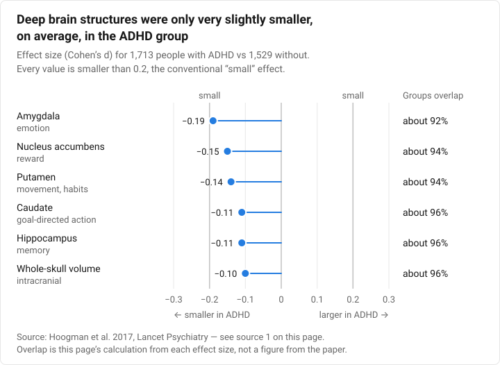
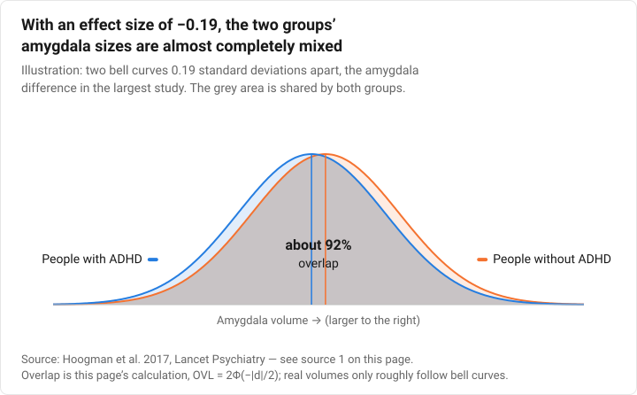
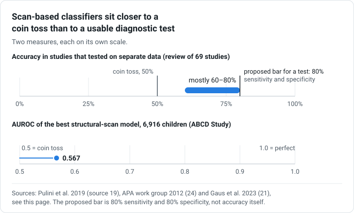

# Does ADHD mean my brain is damaged or "three years behind"?

> **Short answer:** No. Large scan studies comparing people with and without ADHD find small average differences, not damage, mostly in children. In the largest studies the two groups overlap by more than 90%. "Three years behind" describes one cortical measure, averaged over one group of children, and no brain scan can diagnose ADHD.

## What the evidence shows

This page covers structural scans: pictures of the brain's size, shape and wiring, taken with MRI (magnetic resonance imaging). Scans of brain activity, dopamine and brain waves are on [Is ADHD caused by low dopamine?](dopamine-noradrenaline-and-myths.md).

Every finding below is a group average. The comparison group (often called "controls" or "typically developing") is people of similar age without ADHD.

### Deep brain structures: very slightly smaller, on average

**The largest study found tiny differences.** The ENIGMA-ADHD consortium pooled MRI scans from 1,713 people with ADHD and 1,529 without, across 23 sites, aged 4 to 63 (median 14) [1]. Several deep brain structures were smaller on average in the ADHD group. The size of each difference is given as Cohen's *d*, which measures the gap between two group averages in units of how spread out people are; a *d* of 0.2 is conventionally called "small".

| Structure | Effect size (*d*) | How much the two groups overlap |
|---|---|---|
| Amygdala (involved in emotion) | −0.19 | about 92% |
| Nucleus accumbens (reward) | −0.15 | about 94% |
| Putamen (movement, habits) | −0.14 | about 94% |
| Caudate (goal-directed action) | −0.11 | about 96% |
| Hippocampus (memory) | −0.11 | about 96% |
| Whole-skull (intracranial) volume | −0.10 | about 96% |

The effect sizes are from the paper [1]. The overlap column is this page's own calculation from each effect size, not a figure from the paper; the method is in the box at the end of this section.

<picture>
  <source media="(prefers-color-scheme: dark)" srcset="../assets/charts/02/enigma-subcortical-effect-sizes-dark.svg">
  
</picture>

*The ENIGMA effect sizes from the table above, plotted against the conventional "small" mark of 0.2; these are group averages across all ages, and the differences were mainly in children.*

**The two groups are almost completely mixed together.** An overlap of 92–96% means that if you lined up everyone's amygdala size, people with and without ADHD would be almost completely mixed. The pallidum and thalamus showed no difference [1].

<picture>
  <source media="(prefers-color-scheme: dark)" srcset="../assets/charts/02/amygdala-overlap-dark.svg">
  
</picture>

*An illustration of what d = −0.19 looks like, not real scan data; it assumes bell-shaped distributions with equal spread, which brain volumes only roughly follow.*

**The differences were in children, not adults.** Effect sizes were larger in children under 15 than in adults over 21; for the accumbens, for example, *d* was −0.19 in children and −0.10 in adults [1]. In adults, none of the differences was statistically significant [1].

**Medication did not explain the ENIGMA differences.** Results were the same whether or not people had taken stimulant medication, and comorbid conditions (other diagnoses alongside ADHD) did not change them [1]. The authors wrote that this refuted medication effects on brain volume suggested by earlier meta-analyses. Those earlier studies are described below, because the two sets of results disagree.

### Overall brain size: a few per cent smaller in one long-running study

**A US study scanned children repeatedly between 1991 and 2001.** It included 152 children and teenagers with ADHD and 139 without, aged about 5 to 18, collecting 544 scans in total [2]. At the first scan, total brain volume was 3.2% smaller in the ADHD group and the cerebellum (at the back of the brain, involved in coordination and timing) was 3.5% smaller.

**The gap stayed roughly the same with age, except in one structure.** Growth curves for the ADHD and comparison groups ran roughly parallel through childhood and adolescence [2]. The caudate was the exception: its difference disappeared during adolescence.

**Children never given medication showed larger differences.** In the 49 never-medicated children, total white matter volume was 10.7% smaller than in controls and 8.9% smaller than in medicated children with ADHD [2]. The study was observational, so it cannot show whether medication caused that difference.

**Earlier small studies pointed the same way.** A 2007 meta-analysis (a study that pools results from many studies) of MRI studies found smaller volumes overall in ADHD, with a pooled standardised difference of 0.41 across all regions [3]. On this page's calculation that is still about 84% overlap. The largest and most often measured differences were in the cerebellum, the splenium (rear part) of the corpus callosum, total and right brain volume, and the right caudate [3].

### Grey matter maps and the medication question

**Grey matter maps point to the basal ganglia.** Voxel-based morphometry (VBM) compares the amount of grey matter, the brain's cell-rich tissue, point by point across the brain. A 2008 VBM meta-analysis of 7 studies (114 people with ADHD or related conditions, 143 without) found less grey matter in the right putamen and globus pallidus [4]. A 2011 meta-analysis of 14 datasets (378 with ADHD, 344 without) found the most consistent reduction in the right lentiform nucleus (putamen plus globus pallidus), extending to the caudate [5].

**These studies linked age and medication to smaller differences.** In the 2011 analysis, older samples and samples with more people taking stimulants both had more normal values in that region [5]. A 2012 meta-analysis also reported smaller basal ganglia in children with ADHD, smaller anterior cingulate cortex in adults, and fewer differences in groups with more treated participants [6].

**This disagrees with the larger ENIGMA study.** ENIGMA, with far more individual scans, found no effect of stimulant medication [1]. None of these studies randomly assigned medication, so none can settle whether medication changes brain structure.

### The cortex: surface area in children, and the "three years" finding

**Surface area was slightly lower in children only.** A second ENIGMA analysis of 2,246 people with ADHD and 1,934 without, from 36 centres, looked at the cortex (the brain's folded outer layer) [7]. Children with ADHD had slightly lower cortical surface area, mainly in frontal, cingulate and temporal regions; the largest effect was for total surface area, *d* = −0.21, meaning the groups overlap by about 92% (this page's calculation). Thickness was lower in two regions in children (the fusiform gyrus and temporal pole), and adolescents and adults showed no differences in surface area or thickness [7].

**A population sample pointed the same way.** In 2,707 children from a Dutch population cohort (Generation R), lower surface area in an overlapping set of regions went with more attention problems, measured on a parent questionnaire [7]. The authors read this as support for ADHD behaving like a continuous trait across the population, rather than a separate category.

**"Three years behind" means one measure, in children, at group level.** A US study of 223 children with ADHD and 223 without measured cortical thickness at more than 40,000 points from 824 scans, and recorded the age at which thickness peaked (the cortex thickens in childhood, then thins) [8]. Half of the cortex had reached its peak by 10.5 years in the ADHD group and by 7.5 years in the comparison group. The delay was largest in prefrontal regions involved in attention and planning, and the order in which regions matured was the same in both groups [8].

**It is not a measure of a person's "brain age".** The study was set up to ask whether ADHD reflects a delay in typical development or a different pattern altogether, and its results fitted a delay [8]. It is about the timing of one cortical measure in children, averaged over a group, not about emotional maturity, intelligence or a person's "brain age". In the US National Institute of Mental Health's announcement, the lead author cautioned that brain imaging was not yet ready to be used to diagnose ADHD [9].

### A large population-based sample: differences even smaller

**In about 10,700 American 9- and 10-year-olds, differences were very small.** The ABCD Study analysis compared 949 children who met ADHD criteria with 9,787 who did not, on 79 measures of cortical thickness, cortical area and deep brain volume [10]. Only 11 of the 79 measures differed after correcting for multiple comparisons, all slightly smaller in ADHD, with *d* between −0.06 and −0.11. That is about 96–98% overlap (this page's calculation).

**This sample differs from clinic samples.** ADHD in ABCD was identified from parent reports of symptoms, not clinical diagnosis, and the children were drawn from the general population rather than from clinics [10]. The authors' simulations suggested the study could still detect differences despite some misclassification.

### White matter: the brain's wiring

**Diffusion scans measure the brain's wiring.** Diffusion tensor imaging (DTI) tracks how water moves along white matter, the bundles of fibres that connect brain regions. Its main measure, fractional anisotropy (FA), is a rough index of how organised those fibres are; lower FA is often read as less organised wiring, though motion and scan settings also affect it.

**Results point to the corpus callosum, but are inconsistent.** Early meta-analyses found differences in tracts including the corona radiata, internal capsule and cerebellum [11] and lower FA in the splenium of the corpus callosum, which links the two halves of the brain [12]. The largest review, of 129 studies (6,739 people with ADHD and 6,476 without), found the most consistent lower FA in the splenium and body of the corpus callosum, extending to the cingulum [13].

**The finding is fragile.** In that review, about 68% of studies were rated low quality, the difference did not hold in children analysed alone, and the analysis restricted to high-quality datasets found no significant difference [13]. Another meta-analysis found that, among studies confirming the two groups moved equally in the scanner, four of six showed no FA difference; because head movement lowers FA on its own, this matters [14]. A systematic review of 46 child studies reported atypical white matter in many tracts but no clear link to symptoms [15].

### Comparisons across conditions and brain halves

**ENIGMA compared ADHD, autism and OCD directly.** Using scans from 5,827 controls, 2,271 people with ADHD, 1,777 with autism and 2,323 with obsessive-compulsive disorder (OCD), it found no differences shared by all three [16]. Children and adolescents with ADHD had slightly smaller whole-skull volume than controls and than both other groups.

**Left–right differences were tiny and unreliable.** An ENIGMA study of brain asymmetry in up to 1,933 people with ADHD and 1,829 without found effects between *d* = −0.18 and 0.18, none surviving correction for the number of tests [17]. It found no evidence for the altered caudate asymmetry reported by earlier small studies.

### What each kind of structural scan has found

| What is measured | ADHD compared with people without ADHD | Typical size | Sources |
|---|---|---|---|
| Deep brain volumes (amygdala, accumbens, putamen, caudate, hippocampus) | Slightly smaller in children; not significant in adults | *d* −0.11 to −0.19 (92–96% overlap) | [1] |
| Whole-brain and whole-skull volume | Slightly smaller, mainly in children and adolescents | *d* −0.10 in ENIGMA; 3.2% smaller in one cohort | [1], [2], [16] |
| Grey matter maps (VBM) | Less grey matter in right basal ganglia; less abnormal in older and medicated samples | Location only; no single effect size | [4], [5], [6] |
| Cortical surface area | Lower in children; no difference in adolescents or adults | Total area *d* −0.21 (92% overlap) | [7] |
| Cortical thickness | Mostly no difference; peak reached later in one child cohort | Delay of about 3 years at group level | [7], [8] |
| Population sample, ages 9–10 (thickness, area, volume) | 11 of 79 measures slightly smaller | *d* −0.06 to −0.11 (96–98% overlap) | [10] |
| White matter (DTI) | Lower FA in the corpus callosum in pooled studies; not robust in children or high-quality studies | Inconsistent | [11]–[15] |
| Left–right asymmetry | No reliable difference | *d* within ±0.18, none significant after correction | [17] |

Overlap figures are this page's calculation from the published effect sizes.

### No single region, and no diagnostic scan

**There is no single "ADHD brain region".** A meta-analysis of 96 structural and functional imaging studies in young people (1,914 participants) looked for brain regions that consistently differed, and its main analyses found none [18]. The authors called for larger studies and suggested that ADHD may depend more on how brain networks interact than on any one region.

**Computer classifiers work less well than early studies claimed.** Machine-learning programs can be trained to sort scans into "ADHD" and "no ADHD". A review of 69 such studies found that high reported accuracies were inflated by small samples and by testing programs on data used to build them; studies that kept these separate mostly reported 60–80% accuracy [19]. In the public ADHD-200 dataset, correcting for differences between scanning sites caused a large drop in accuracy [20].

**Large-sample classifiers are only a little better than chance.** One measure of accuracy, the AUROC, runs from 0.5 (a coin toss) to 1.0 (perfect). In 6,916 children from the ABCD Study, the best structural-scan model reached 0.567 for ADHD, which its authors said does not warrant clinical use [21]. A model trained on ENIGMA scans separated ADHD from controls better than chance in both children and adults, and better in children [22].

<picture>
  <source media="(prefers-color-scheme: dark)" srcset="../assets/charts/02/scan-classifiers-vs-chance-dark.svg">
  
</picture>

*Classifier results from sources 19, 21 and 24 on one picture; the 80% bar is for sensitivity and specificity, which is related to, but not the same as, overall accuracy.*

**Scans cannot diagnose ADHD.** Because the groups overlap so heavily, a scan cannot tell whether an individual has ADHD. The UK NICE guideline says diagnosis should be made only by a specialist psychiatrist, paediatrician or other appropriately qualified professional, after a full clinical and psychosocial assessment, and not on the basis of rating scales or observation alone [23]. Brain scans are not part of the assessment it describes.

**Professional guidance does not support diagnostic scans.** A 2012 consensus report from an American Psychiatric Association work group stated that neuroimaging is not recommended, in US or European practice guidelines, for positively diagnosing any primary psychiatric disorder [24]. It proposed that a diagnostic imaging test should reach at least 80% sensitivity and specificity, and the accuracies reported for ADHD in large or independent samples, above, fall short of that. Some clinics nonetheless sell brain scans (often SPECT) to diagnose or "type" ADHD; that use is not supported by these guidelines.

The big shared datasets this evidence comes from (1 min)

- **ENIGMA-ADHD:** an international working group founded in 2013 that pools scans already collected by research sites, processed the same way, to overcome small samples and mixed methods [25]. Its cortical analysis drew on 36 centres [7].
- **ADHD-200:** a public dataset released in 2011 with structural and resting-state scans plus background information for nearly 1,000 young people with and without ADHD from eight centres, released with a competition to predict diagnosis from scans [20], [26].
- **ABCD Study:** the largest children's brain imaging study in the USA, which recruited 9- and 10-year-olds between 2016 and 2018 to reflect the US population [10].
- **Generation R and NeuroIMAGE:** a Dutch population cohort of children (2,707 scanned in the cortical analysis) and a family study comparing people with ADHD, their unaffected siblings and controls (506 people) [7].

How the overlap figures were calculated (under 1 min)

The overlap figures use the overlapping coefficient for two bell-shaped (normal) distributions with equal spread, OVL = 2Φ(−|*d*|/2). Real brain volumes only approximate this shape, so treat the percentages as rough guides. For a sense of scale, *d* = 0.2 gives about 92% overlap and *d* = 0.5 about 80%.

## What is uncertain or debated

- **Why the child differences fade.** The adult null results may mean brains converge with age, or that adults who still meet criteria differ from children who do, or both. Cross-sectional data, which scan each person once, cannot separate these; a machine-learning study did find features shared by children and adults [22].
- **Whether medication changes brain structure.** Smaller meta-analyses linked stimulant use to more typical brain measures [5], [6], while the much larger ENIGMA study found no medication effect [1]. No randomised trial has settled it.
- **White matter in adults versus children.** Corpus callosum differences were clearer in older samples and absent in children analysed alone, which may reflect late fibre development or poor scan quality in many studies [13].
- **Brain differences or brain consequences?** Imaging shows associations. It cannot show whether a structural difference contributes to ADHD, follows from living with it, or reflects shared genetic influences.
- **Clinic versus population samples.** Population samples such as ABCD found smaller differences than some clinic samples [10]. Possible reasons include milder ADHD in the general population and identification by parent report; the evidence cannot yet separate them.
- **"30% behind".** The popular claim that people with ADHD are about 30% behind in "executive age" has been attributed to talks by the psychologist Russell Barkley. No peer-reviewed source for this figure was found, and it is not the same claim as the Shaw finding above.
- **Small effects can still matter for science.** Tiny average differences can point to biological pathways. They cannot describe any individual reader.

## What this means for you

At group level, ADHD is associated with small, mostly childhood differences in brain structure, not with damage or a missing part. Your own brain could sit anywhere in those overlapping ranges. If you were diagnosed as an adult, the largest adult scan comparisons found no reliable differences in brain volume or cortex, and the white matter findings are not yet robust.

ADHD is real for other reasons: the genetic, cognitive and outcome evidence on the pages below.

## Related pages

- [Is ADHD caused by low dopamine?](dopamine-noradrenaline-and-myths.md)
- [Why is my ADHD so different from someone else's?](why-no-two-adhd-brains-are-alike.md)
- [Is ADHD genetic, and will my children have it?](genes-and-inheritance.md)
- [How is ADHD diagnosed, and why is there no test?](../01-is-this-real/how-diagnosis-works.md)
- [How to read the evidence](../08-reading-this-well/how-to-read-the-evidence.md)
- [Back to all worries](../README.md#find-your-worry)

## Sources

1. Hoogman M, et al. Subcortical brain volume differences in participants with attention deficit hyperactivity disorder in children and adults: a cross-sectional mega-analysis. *Lancet Psychiatry*. 2017;4(4):310–319. DOI 10.1016/S2215-0366(17)30049-4. PMID 28219628. — **Evidence: Strong**, mega-analysis of 3,242 individual scans from 23 sites; effects tiny; cross-sectional.
2. Castellanos FX, et al. Developmental trajectories of brain volume abnormalities in children and adolescents with attention-deficit/hyperactivity disorder. *JAMA*. 2002;288(14):1740–1748. DOI 10.1001/jama.288.14.1740. PMID 12365958. — **Evidence: Moderate**, one longitudinal cohort of 291 young people; observational medication comparison.
3. Valera EM, et al. Meta-analysis of structural imaging findings in attention-deficit/hyperactivity disorder. *Biological Psychiatry*. 2007;61(12):1361–1369. DOI 10.1016/j.biopsych.2006.06.011. PMID 16950217. — **Evidence: Moderate**, meta-analysis of small region-of-interest studies (search to January 2005).
4. Ellison-Wright I, et al. Structural brain change in attention deficit hyperactivity disorder identified by meta-analysis. *BMC Psychiatry*. 2008;8:51. DOI 10.1186/1471-244X-8-51. PMID 18590567. — **Evidence: Limited**, 7 small VBM studies, 257 people in total.
5. Nakao T, et al. Gray matter volume abnormalities in ADHD: voxel-based meta-analysis exploring the effects of age and stimulant medication. *American Journal of Psychiatry*. 2011;168(11):1154–1163. DOI 10.1176/appi.ajp.2011.11020281. PMID 21865529. — **Evidence: Moderate**, 14 datasets, 722 people; medication and age effects are cross-study associations.
6. Frodl T, Skokauskas N. Meta-analysis of structural MRI studies in children and adults with attention deficit hyperactivity disorder indicates treatment effects. *Acta Psychiatrica Scandinavica*. 2012;125(2):114–126. DOI 10.1111/j.1600-0447.2011.01786.x. PMID 22118249. — **Evidence: Limited to moderate**, meta-analysis of small VBM and tracing studies; treatment link is observational.
7. Hoogman M, et al. Brain imaging of the cortex in ADHD: a coordinated analysis of large-scale clinical and population-based samples. *American Journal of Psychiatry*. 2019;176(7):531–542. DOI 10.1176/appi.ajp.2019.18091033. PMID 31014101. — **Evidence: Strong**, 4,180 scans from 36 centres plus a family study and a population cohort.
8. Shaw P, et al. Attention-deficit/hyperactivity disorder is characterized by a delay in cortical maturation. *PNAS*. 2007;104(49):19649–19654. DOI 10.1073/pnas.0707741104. PMID 18024590. — **Evidence: Moderate**, one longitudinal cohort, 223 children per group, one cortical measure.
9. National Institute of Mental Health. Brain matures a few years late in ADHD, but follows normal pattern. Press release, 12 November 2007. nimh.nih.gov. — **Evidence: Expert commentary**, institutional summary of source 8; the lead author's caution was confirmed from search excerpts, not the full release.
10. Bernanke J, et al. Structural brain measures among children with and without ADHD in the Adolescent Brain and Cognitive Development Study cohort: a cross-sectional US population-based study. *Lancet Psychiatry*. 2022;9:222–231. DOI 10.1016/S2215-0366(21)00505-8. PMID 35143759. — **Evidence: Strong**, 10,736 children; ADHD by parent report, ages 9–10 only.
11. van Ewijk H, et al. Diffusion tensor imaging in attention deficit/hyperactivity disorder: a systematic review and meta-analysis. *Neuroscience and Biobehavioral Reviews*. 2012;36(4):1093–1106. DOI 10.1016/j.neubiorev.2012.01.003. PMID 22305957. — **Evidence: Limited**, 15 small studies.
12. Chen L, et al. A systematic review and meta-analysis of tract-based spatial statistics studies regarding attention-deficit/hyperactivity disorder. *Neuroscience and Biobehavioral Reviews*. 2016;68:838–847. DOI 10.1016/j.neubiorev.2016.07.022. PMID 27450582. — **Evidence: Limited to moderate**, coordinate meta-analysis of small DTI studies.
13. Parlatini V, et al. White matter alterations in attention-deficit/hyperactivity disorder (ADHD): a systematic review of 129 diffusion imaging studies with meta-analysis. *Molecular Psychiatry*. 2023;28:4098–4123. DOI 10.1038/s41380-023-02173-1. PMID 37479785. — **Evidence: Moderate**, largest review, but most included studies low quality and the high-quality analysis was null.
14. Aoki Y, et al. Research Review: Diffusion tensor imaging studies of attention-deficit/hyperactivity disorder: meta-analyses and reflections on head motion. *Journal of Child Psychology and Psychiatry*. 2018;59:193–202. DOI 10.1111/jcpp.12778. PMID 28671333. — **Evidence: Moderate**, 27 datasets; shows head motion as a likely confounder.
15. Connaughton M, et al. White matter microstructure in children and adolescents with ADHD. *NeuroImage: Clinical*. 2022;33:102957. DOI 10.1016/j.nicl.2022.102957. PMID 35149304. — **Evidence: Limited to moderate**, systematic review of 46 studies without pooled statistics.
16. Boedhoe PSW, et al. Subcortical brain volume, regional cortical thickness, and cortical surface area across disorders: findings from the ENIGMA ADHD, ASD, and OCD working groups. *American Journal of Psychiatry*. 2020;177:834–843. DOI 10.1176/appi.ajp.2020.19030331. PMID 32539527. — **Evidence: Strong**, about 12,000 scans from 151 cohorts.
17. Postema MC, et al. Analysis of structural brain asymmetries in attention-deficit/hyperactivity disorder in 39 datasets. *Journal of Child Psychology and Psychiatry*. 2021;62:1202–1219. DOI 10.1111/jcpp.13396. PMID 33748971. — **Evidence: Strong**, largest asymmetry analysis; null after correction.
18. Samea F, et al. Brain alterations in children/adolescents with ADHD revisited: a neuroimaging meta-analysis of 96 structural and functional studies. *Neuroscience and Biobehavioral Reviews*. 2019;100:1–8. DOI 10.1016/j.neubiorev.2019.02.011. PMID 30790635. — **Evidence: Moderate**, coordinate meta-analysis; null main result (a sub-analysis of one task type found a left pallidum/putamen difference).
19. Pulini AA, et al. Classification accuracy of neuroimaging biomarkers in attention-deficit/hyperactivity disorder: effects of sample size and circular analysis. *Biological Psychiatry: Cognitive Neuroscience and Neuroimaging*. 2019;4(2):108–120. DOI 10.1016/j.bpsc.2018.06.003. PMID 30064848. — **Evidence: Moderate**, methodological review of 69 classification studies.
20. Olivetti E, et al. ADHD diagnosis from multiple data sources with batch effects. *Frontiers in Systems Neuroscience*. 2012;6:70. DOI 10.3389/fnsys.2012.00070. PMID 23060755. — **Evidence: Limited**, one methods study on the ADHD-200 data.
21. Gaus R, et al. Can we diagnose mental disorders in children? A large-scale assessment of machine learning on structural neuroimaging of 6916 children in the adolescent brain cognitive development study. *JCPP Advances*. 2023;3:e12184. DOI 10.1002/jcv2.12184. PMID 38054056. — **Evidence: Moderate**, large sample, one cohort of 9- and 10-year-olds.
22. Zhang-James Y, et al. Evidence for similar structural brain anomalies in youth and adult attention-deficit/hyperactivity disorder: a machine learning analysis. *Translational Psychiatry*. 2021;11:82. DOI 10.1038/s41398-021-01201-4. PMID 33526765. — **Evidence: Moderate**, ENIGMA-ADHD scans from about 4,000 people; accuracy figures not given in the abstract.
23. National Institute for Health and Care Excellence. Attention deficit hyperactivity disorder: diagnosis and management (NG87). Published March 2018; last substantive update September 2019; minor change May 2025 (link to HealthTech guidance added); last reviewed July 2026. nice.org.uk/guidance/ng87. — **Evidence: Guideline**, UK national guideline.
24. American Psychiatric Association, Work Group on Neuroimaging Markers of Psychiatric Disorders (chair: First M). Consensus report of the APA Work Group on Neuroimaging Markers of Psychiatric Disorders. Resource document, approved by the APA Board of Trustees, July 2012. psychiatry.org. — **Evidence: Expert consensus**, professional-body work group report; the 80% criterion was confirmed from search excerpts of the document, not the full text.
25. Hoogman M, et al. Consortium neuroscience of attention deficit/hyperactivity disorder and autism spectrum disorder: the ENIGMA adventure. *Human Brain Mapping*. 2022;43:37–55. DOI 10.1002/hbm.25029. PMID 32420680. — **Evidence: Expert commentary**, narrative review by the consortium's own investigators.
26. ADHD-200 Consortium. The ADHD-200 Consortium: a model to advance the translational potential of neuroimaging in clinical neuroscience. *Frontiers in Systems Neuroscience*. 2012;6:62. DOI 10.3389/fnsys.2012.00062. PMID 22973200. — **Evidence: Expert commentary**, opinion article describing the dataset.

---
Last reviewed: November 2026 · [How these pages are made](../08-reading-this-well/sources-and-guidelines.md) · [Not medical advice](../08-reading-this-well/not-medical-advice.md)
