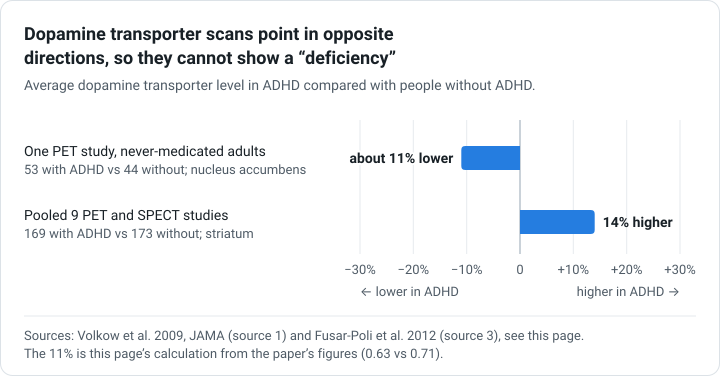

# Is ADHD caused by low dopamine?

> **Short answer:** Not in any simple sense. Dopamine and noradrenaline, two chemical messengers in the brain, seem involved, and most ADHD medicines increase their signalling. But dopamine scans disagree on the direction of the difference, activity scans show small, inconsistent group differences, and no test measures a "dopamine level". A medicine helping does not show that low dopamine caused the problem.

## What the evidence shows

This page is the home for scans of brain **chemistry** and brain **activity**, comparing people with ADHD against comparison groups (also called controls: people without ADHD, studied the same way). Scans of brain size and shape are on [Does ADHD mean my brain is damaged or "three years behind"?](brain-structure-and-development.md). Every finding below is an average across a group; none describes any one person.

### Dopamine scans: lower in some studies, higher in others

**One large PET study found lower dopamine markers.** PET (positron emission tomography) uses a mildly radioactive tracer to measure molecules in the living brain. It compared 53 adults with ADHD who had never taken medication for it with 44 adults without ADHD [1]. The ADHD group had lower availability of the dopamine transporter (DAT, the protein that clears dopamine away after it is released) and of dopamine D2/D3 receptors in parts of the brain's reward pathway, mainly on the left side [1].

**The differences were modest and overlapping.** In the nucleus accumbens (a reward area), the average transporter measure was 0.63 in the ADHD group and 0.71 in the comparison group, about 11% lower (this page's calculation from the paper's figures) [1]. Lower receptor values went with more inattention, but the correlations were modest (*r* of about 0.3 to 0.4, where 0 is no link and 1 a perfect one) [1]. This is one research site, in adults only.

**A smaller study from the same group measured dopamine release.** In 19 never-medicated adults with ADHD and 24 without, a stimulant given by injection produced a smaller rise in dopamine in the caudate (a deep structure involved in goal-directed action) in the ADHD group, and this smaller rise went with more inattention [2]. The sample was small and has not been widely repeated.

**Pooled studies point the other way.** A meta-analysis (a study that statistically combines earlier studies) of 9 PET and SPECT studies, covering 169 people with ADHD and 173 without, found striatal DAT density was, on average, 14% *higher* in ADHD [3]. SPECT (single-photon emission computed tomography) is a cheaper, lower-resolution relative of PET. Differences between studies were large, and density tended to be higher in people who had previously taken stimulants and lower in people who never had, which raised the possibility that the brain adapts to the medicine [3].

**Even that medication explanation is disputed.** In a published letter, Spencer and colleagues argued that the meta-analysis classified studies inconsistently as medication-free or previously medicated, and that one study it relied on actually showed *lower* transporter binding in previously medicated adults [4]. The journal record shows that the meta-analysis authors published a reply alongside it [4]; its content was not checked for this page. Either way, a finding that can go in both directions cannot support the claim that ADHD is a dopamine deficiency.

<picture>
  <source media="(prefers-color-scheme: dark)" srcset="../assets/charts/02/dopamine-transporter-direction-dark.svg">
  
</picture>

*Two dopamine transporter findings pointing in opposite directions; they measured slightly different areas and groups, and the 14% average hides large differences between studies.*

### Brain activity during tasks: less activity in attention and control networks

**Task fMRI compares brain activity while people do a test.** Functional MRI (fMRI) tracks changes in blood oxygen, a stand-in for how hard a brain area is working. The meta-analyses below report *where* differences turn up consistently across studies, not how large they are for individuals.

**Across 55 studies, the clearest pattern was under-activity in control and attention networks.** In children (39 studies), people with ADHD showed less activity than comparison groups mainly in the frontoparietal network (front and side areas used for executive control, the mental skills used to plan, hold information in mind and stop an action) and the ventral attention network (areas that redirect attention to something new) [5]. In adults (16 studies), under-activity was mainly frontoparietal [5]. Some networks, including the default mode network (areas most active when the mind is at rest or wandering), showed *more* activity in ADHD, and the differences appeared even in people with no other diagnosis and no history of stimulant treatment [5].

**Stopping and attention tasks show two partly separate patterns.** A second meta-analysis pooled 21 datasets on stopping an action (287 people with ADHD, 320 without) and 13 on sustained attention (171 with, 178 without) [6]. During stopping, the ADHD groups showed less activity in the right inferior frontal cortex, the supplementary motor area and the anterior cingulate, as well as in deep striatal and thalamic areas; during attention tasks, less activity in the right dorsolateral prefrontal cortex, basal ganglia, thalamus and parietal areas [6]. Long-term stimulant use was linked to more typical activity in one area (the right caudate) during attention tasks, which the authors called preliminary [6].

**The pattern differs from a condition with a similar weakness.** A meta-analysis compared ADHD with obsessive-compulsive disorder (OCD), which also involves trouble stopping actions, using 33 ADHD fMRI datasets (489 people with ADHD, 591 without) [7]. Under-activity in the right ventrolateral prefrontal cortex was specific to ADHD, and the basal ganglia and insula were under-active in ADHD but over-active in OCD [7]. So a shared symptom does not mean a shared brain pattern.

**Reward anticipation produces less response in the ventral striatum.** The ventral striatum is a deep reward area rich in dopamine. A meta-analysis of fMRI studies in which people waited for a possible reward found a medium-sized reduction in its response in ADHD, *d* = 0.48 to 0.58 [8]. Cohen's *d* measures the gap between two group averages in units of how spread out people are; these values mean the two groups' scores overlap by roughly 77–81% (this page's calculation, not a figure from the paper).

### Brain activity at rest: no agreed pattern

**Resting-state fMRI looks at which areas rise and fall together while a person lies still.** This "functional connectivity" is used as a measure of how brain networks communicate.

**Meta-analyses disagree, and the most cautious found nothing consistent.** A preregistered meta-analysis of 30 studies (1,094 people with ADHD, 884 without) found no brain location where differences in connectivity converged across studies [9]. Two other meta-analyses did report patterns, but different ones: reduced connectivity within the core of the default mode network (20 studies, 944 with ADHD, 1,121 without) [10], and over-connection between the frontoparietal and default mode networks (21 studies, 700 with ADHD, 580 without) [11].

**The largest analysis found real but tiny differences.** A 2024 mega-analysis (pooling raw scans rather than published results) of 1,696 young people with ADHD and 6,737 without found stronger connectivity between the striatum and several cortical areas in ADHD [12]. The largest effect was *d* = 0.15, meaning the two groups overlap by about 94% (this page's calculation) [12]. The authors concluded that resting-state connectivity "can capture only a fraction" of ADHD's biology [12].

### Brain waves (EEG): a shrinking difference

**EEG and QEEG measure electrical brain waves through the scalp.** EEG (electroencephalography) records the waves; QEEG (quantitative EEG) converts them into numbers. The best-known ADHD measure is the theta/beta ratio, which compares slower theta waves with faster beta waves.

**The theta/beta difference has shrunk over time.** A meta-analysis of 9 studies (1,253 children and adolescents aged 6–18 with ADHD and 517 without) reported an average effect of 0.62 for ages 6–18, but the authors called this misleading and an overestimate because results varied so much between studies [13]. The gap narrowed in more recent studies, because comparison groups' ratios rose, and the authors concluded that a high ratio "cannot be considered a reliable diagnostic measure" of ADHD [13].

**One large sample found no difference in young people.** In 871 participants (595 young people and 276 adults) with and without ADHD, the theta/beta ratio did not differ by ADHD status in young people, and was *lower*, not higher, in adults with ADHD [14]. ADHD presentation and other conditions such as depression pushed the ratio in opposite directions [14].

**A regulator cleared one EEG device as an aid only.** In 2013 the US Food and Drug Administration (FDA) cleared the NEBA system, which measures the theta/beta ratio, for use in 6- to 17-year-olds alongside a clinician's full evaluation, not as a stand-alone test [15]. A later review argued that inconsistent findings and limited specificity threaten the ratio's use as an ADHD marker [16].

### What functional and chemical scans have found, ADHD vs comparison groups

| Method | Who was compared | Finding in ADHD, on average | Size or strength | Source | Evidence |
|---|---|---|---|---|---|
| PET, dopamine transporter and receptors | 53 never-medicated adults vs 44 | Lower, mainly left reward pathway | About 11% lower in nucleus accumbens; one site | [1] | Limited |
| PET, dopamine release after a stimulant | 19 never-medicated adults vs 24 | Smaller release in caudate | Small sample | [2] | Limited |
| PET/SPECT, striatal dopamine transporter | 9 studies; 169 vs 173 | 14% *higher* on average; direction varies | Large between-study differences; medication history disputed | [3, 4] | Contested |
| Task fMRI, many tasks | 55 studies (39 child, 16 adult) | Less activity in control and attention networks; more in some others | Location only, no effect size | [5] | Moderate |
| Task fMRI, stopping and attention | 21 datasets (287 vs 320); 13 datasets (171 vs 178) | Less activity in right frontal, striatal and parietal areas | Location only | [6] | Moderate |
| Task fMRI, stopping, ADHD vs OCD | 33 ADHD datasets (489 vs 591) | Right ventrolateral prefrontal under-activity specific to ADHD | Location only | [7] | Moderate |
| Task fMRI, waiting for a reward | Pooled fMRI studies | Less ventral striatum response | *d* = 0.48–0.58; about 77–81% overlap | [8] | Moderate |
| Resting-state fMRI, meta-analyses | 30 studies (1,094 vs 884) | No consistent location | Other meta-analyses report different patterns | [9, 10, 11] | Contested |
| Resting-state fMRI, mega-analysis | 1,696 vs 6,737 young people | Stronger striatum–cortex connectivity | Largest *d* = 0.15; about 94% overlap | [12] | Strong (for a tiny effect) |
| EEG theta/beta ratio | 9 studies of children and adolescents | Higher ratio, shrinking over time | 0.62, an overestimate | [13] | Contested |
| EEG theta/beta ratio | 871 young people and adults | No difference in youth; lower in adults | One large sample | [14] | Moderate |

Overlap figures are this page's calculation from each effect size, not figures from the papers. They use the overlapping coefficient for two normal distributions with equal spread, OVL = 2Φ(−|*d*|/2).

### Medicines, dopamine and noradrenaline

**Stimulants block the dopamine transporter, in people with and without ADHD.** A PET study in 7 adults without ADHD found that oral methylphenidate blocked the dopamine transporter in proportion to the dose, and that at the doses used in treatment it is likely to block more than half of the transporters [17]. This shows how the medicine acts, not what is different in ADHD. How the medicines work is covered in [how ADHD medicines work](../06-treatment-what-works/how-adhd-medicines-work.md).

**ADHD medicines raise dopamine and noradrenaline signalling in the prefrontal cortex.** Stimulants such as methylphenidate and amphetamine, and the non-stimulant atomoxetine, increase the action of dopamine and noradrenaline (also called norepinephrine) in the prefrontal cortex, the front part of the brain involved in planning and attention, by blocking the transporters that clear them away [18]. Much of this mechanism comes from animal studies. The prefrontal cortex is very sensitive to these chemicals: either too little or too much markedly impairs its function [18].

**Some effective medicines act mainly on noradrenaline, not dopamine.** Guanfacine mimics the effect of noradrenaline at a receptor in the prefrontal cortex (the alpha-2A adrenoceptor), and atomoxetine works mainly through noradrenaline [18].

**Both chemicals tune whole circuits, not a single spot.** A review of the brain chemistry described dopamine and noradrenaline as regulating circuits that link the frontal cortex with the striatum (deep structures involved in movement and reward). It concluded that the precise way the drugs produce their benefit "remain[s] to be fully specified" [19].

**Genetics implicates dopamine neurons, among many others.** The largest genetic study of ADHD, with 38,691 people with ADHD, found risk linked to several brain-specific neuron types, including midbrain dopamine neurons, and to genes active in early brain development generally [20]. The older "dopamine genes" have only small effects, as [Is ADHD genetic, and will my children have it?](genes-and-inheritance.md) explains.

**Stimulants affect people without ADHD too.** In a 1978 study, a single dose of dextroamphetamine (an amphetamine) reduced motor activity and improved performance on thinking tests in 14 boys without ADHD [21]. A 1980 study by the same US group compared boys with ADHD (then called hyperactivity), boys without it and young men without it, and all three groups showed less motor activity, better vigilance and better learning-task performance after the drug [22].

**A good response to a stimulant cannot confirm a diagnosis.** Because people without ADHD respond in similar ways, a response on its own cannot show that ADHD is present [22].

### Why "the drug works on dopamine" does not prove "the cause is low dopamine"

A treatment can work without reversing the cause. Paracetamol eases a headache, but a headache is not a paracetamol deficiency; reading glasses correct focus without the cause being a shortage of glass.

In the same way, increasing catecholamine signalling (dopamine and noradrenaline together) can help prefrontal circuits work better whatever the original reason they work differently. The drug-response evidence tells us these chemicals are a useful lever. It cannot tell us they are the root cause, and it is equally consistent with differences in receptors, transporters, circuit wiring or development.

## What is uncertain or debated

- **The direction of the dopamine-transporter findings**, and whether long-term stimulant use changes transporter levels [1, 3, 4].
- **Whether activity differences reflect ADHD or the task.** Many fMRI differences depend on which task was used, and the 55-study meta-analysis found that the differences "largely reflected task features" [5].
- **Whether resting-state differences exist in any consistent place.** Meta-analyses using similar data reached different answers [9, 10, 11], and the largest single analysis found only tiny effects [12].
- **Whether imaging differences cause symptoms, follow from them, or both.** All of these studies compare groups at one point in time.
- **How much noradrenaline matters relative to dopamine.** Effective noradrenaline-focused medicines suggest it matters a lot, but the relative contributions are unknown.
- **Most activity and EEG data come from children**, and most chemical scans from adults, so findings in one age group may not apply to the other.
- **"Dopamine-seeking" explanations of everyday behaviour** (for example, "you scroll because your brain craves dopamine") are popular metaphors. They are not tested claims about any individual's brain chemistry.
- There is **no validated blood, urine or scan test of a "dopamine level"** that can diagnose ADHD or guide treatment. Clinical guidelines base diagnosis on clinical assessment, and an American Psychiatric Association work group stated in 2012 that neuroimaging is not recommended for diagnosing any primary psychiatric disorder, as [Does ADHD mean my brain is damaged or "three years behind"?](brain-structure-and-development.md) explains. Why individual scans fail is covered on [Why is my ADHD so different from someone else's?](why-no-two-adhd-brains-are-alike.md)

## What this means for you

You do not have a measured chemical shortage, because nobody can measure one. The better-supported picture is that, on average, brain circuits regulated by dopamine and noradrenaline tend to work somewhat differently in ADHD, and that medicines can shift how those circuits operate. Whether a medicine is right for you is a decision to make with a prescriber; this page describes the science only.

## Related pages

- [How ADHD medicines work](../06-treatment-what-works/how-adhd-medicines-work.md)
- [Does ADHD mean my brain is damaged or "three years behind"?](brain-structure-and-development.md)
- [Why is my ADHD so different from someone else's?](why-no-two-adhd-brains-are-alike.md)
- [Is ADHD genetic, and will my children have it?](genes-and-inheritance.md)
- [Time, waiting and rewards](../03-why-i-think-and-feel-this-way/time-waiting-and-rewards.md)
- [Myths and corrections](../08-reading-this-well/myths-and-corrections.md)
- [Back to all worries](../README.md#find-your-worry)

## Sources

1. Volkow ND, et al. Evaluating dopamine reward pathway in ADHD: clinical implications. *JAMA*. 2009. DOI 10.1001/jama.2009.1308. PMID 19738093. — **Evidence: Limited**: one PET study, 53 never-medicated adults with ADHD and 44 controls, single site.
2. Volkow ND, et al. Depressed dopamine activity in caudate and preliminary evidence of limbic involvement in adults with attention-deficit/hyperactivity disorder. *Archives of General Psychiatry*. 2007. DOI 10.1001/archpsyc.64.8.932. PMID 17679638. — **Evidence: Limited**: PET, 19 adults with ADHD and 24 controls.
3. Fusar-Poli P, et al. Striatal dopamine transporter alterations in ADHD: pathophysiology or adaptation to psychostimulants? A meta-analysis. *American Journal of Psychiatry*. 2012. DOI 10.1176/appi.ajp.2011.11060940. PMID 22294258. — **Evidence: Contested**: 9 small imaging studies, large heterogeneity, disputed coding.
4. Spencer TJ, et al. Striatal dopamine transporter binding in adults with ADHD [letter, with author reply]. *American Journal of Psychiatry*. 2012. DOI 10.1176/appi.ajp.2012.12020232. PMID 22684601. — **Evidence: Contested**: critique of source 3, not new data.
5. Cortese S, et al. Toward systems neuroscience of ADHD: a meta-analysis of 55 fMRI studies. *American Journal of Psychiatry*. 2012. DOI 10.1176/appi.ajp.2012.11101521. PMID 22983386. — **Evidence: Moderate**: coordinate meta-analysis of 55 task studies; locations, not effect sizes.
6. Hart H, et al. Meta-analysis of functional magnetic resonance imaging studies of inhibition and attention in attention-deficit/hyperactivity disorder: exploring task-specific, stimulant medication, and age effects. *JAMA Psychiatry*. 2013. DOI 10.1001/jamapsychiatry.2013.277. PMID 23247506. — **Evidence: Moderate**: voxel-based meta-analysis, 34 datasets, mostly children.
7. Norman LJ, et al. Structural and functional brain abnormalities in attention-deficit/hyperactivity disorder and obsessive-compulsive disorder: a comparative meta-analysis. *JAMA Psychiatry*. 2016. DOI 10.1001/jamapsychiatry.2016.0700. PMID 27276220. — **Evidence: Moderate**: comparative voxel-based meta-analysis.
8. Plichta MM, Scheres A. Ventral-striatal responsiveness during reward anticipation in ADHD and its relation to trait impulsivity in the healthy population: a meta-analytic review of the fMRI literature. *Neuroscience and Biobehavioral Reviews*. 2014. DOI 10.1016/j.neubiorev.2013.07.012. PMID 23928090. — **Evidence: Moderate**: meta-analysis; effect size confirmed from the abstract, study count not checked.
9. Cortese S, et al. Systematic review and meta-analysis: resting-state functional magnetic resonance imaging studies of attention-deficit/hyperactivity disorder. *Journal of the American Academy of Child and Adolescent Psychiatry*. 2021. DOI 10.1016/j.jaac.2020.08.014. PMID 32946973. — **Evidence: Strong**: preregistered meta-analysis, 30 studies; null result.
10. Sutcubasi B, et al. Resting-state network dysconnectivity in ADHD: a system-neuroscience-based meta-analysis. *World Journal of Biological Psychiatry*. 2020. DOI 10.1080/15622975.2020.1775889. PMID 32468880. — **Evidence: Contested**: 20 seed-based studies; differs from sources 9 and 11.
11. Gao Y, et al. Impairments of large-scale functional networks in attention-deficit/hyperactivity disorder: a meta-analysis of resting-state functional connectivity. *Psychological Medicine*. 2019. DOI 10.1017/S003329171900237X. PMID 31500674. — **Evidence: Contested**: 21 studies; differs from sources 9 and 10.
12. Norman LJ, et al. Subcortico-cortical dysconnectivity in ADHD: a voxel-wise mega-analysis across multiple cohorts. *American Journal of Psychiatry*. 2024. DOI 10.1176/appi.ajp.20230026. PMID 38476041. — **Evidence: Strong**: 8,433 young people in the group comparison; effects very small.
13. Arns M, Conners CK, Kraemer HC. A decade of EEG theta/beta ratio research in ADHD: a meta-analysis. *Journal of Attention Disorders*. 2013. DOI 10.1177/1087054712460087. PMID 23086616. — **Evidence: Contested**: 9 studies, significant heterogeneity, effect declining over time.
14. Loo SK, et al. Characterization of the theta to beta ratio in ADHD: identifying potential sources of heterogeneity. *Journal of Attention Disorders*. 2013. DOI 10.1177/1087054712468050. PMID 23264365. — **Evidence: Moderate**: one large sample of 871 youth and adults.
15. US Food and Drug Administration. De novo classification of the Neuropsychiatric EEG-Based ADHD Assessment Aid (NEBA) System, DEN110019. 2013. accessdata.fda.gov. — **Regulatory decision**, not an evidence summary. Confirmed from search-result summaries of the FDA record; the FDA site could not be opened for this page.
16. Saad JF, et al. Is the theta/beta EEG marker for ADHD inherently flawed? *Journal of Attention Disorders*. 2018. DOI 10.1177/1087054715578270. PMID 25823742. — **Evidence: Moderate**: narrative review.
17. Volkow ND, et al. Dopamine transporter occupancies in the human brain induced by therapeutic doses of oral methylphenidate. *American Journal of Psychiatry*. 1998. DOI 10.1176/ajp.155.10.1325. PMID 9766762. — **Evidence: Limited**: PET in 7 adults without ADHD; mechanism, not a comparison with ADHD.
18. Arnsten AFT. Catecholamine influences on dorsolateral prefrontal cortical networks. *Biological Psychiatry*. 2011. DOI 10.1016/j.biopsych.2011.01.027. PMID 21489408. — **Evidence: Moderate**: review, largely animal mechanism work.
19. Del Campo N, et al. The roles of dopamine and noradrenaline in the pathophysiology and treatment of attention-deficit/hyperactivity disorder. *Biological Psychiatry*. 2011. DOI 10.1016/j.biopsych.2011.02.036. PMID 21550021. — **Evidence: Moderate**: narrative review.
20. Demontis D, et al. Genome-wide analyses of ADHD identify 27 risk loci, refine the genetic architecture and implicate several cognitive domains. *Nature Genetics*. 2023. DOI 10.1038/s41588-022-01285-8. PMID 36702997. — **Evidence: Strong**: genome-wide study, 38,691 people with ADHD; cell-type finding is non-specific.
21. Rapoport JL, et al. Dextroamphetamine: cognitive and behavioral effects in normal prepubertal boys. *Science*. 1978. DOI 10.1126/science.341313. PMID 341313. — **Evidence: Limited**: 14 boys, single-dose crossover.
22. Rapoport JL, et al. Dextroamphetamine. Its cognitive and behavioral effects in normal and hyperactive boys and normal men. *Archives of General Psychiatry*. 1980. DOI 10.1001/archpsyc.1980.01780210091010. PMID 7406657. — **Evidence: Limited**: small single-dose crossover experiment.

---
Last reviewed: November 2026 · [How these pages are made](../08-reading-this-well/sources-and-guidelines.md) · [Not medical advice](../08-reading-this-well/not-medical-advice.md)
