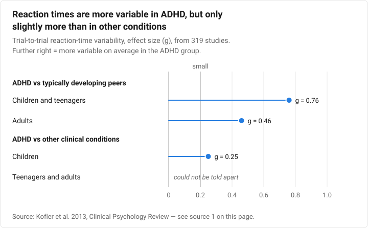

# ADHD and hyperfocus: why can I focus for hours on some things?

> **Short answer:** ADHD seems to involve difficulty *regulating* attention more than having too little of it. On average, attention varies more from moment to moment and slips most on long, unrewarding tasks. Intense focus ("hyperfocus") is widely reported, but the research is small and self-reported, and one study found it no more common in diagnosed adults than in others.

## What the evidence shows

**Attention is more variable, moment to moment.** One of the most consistent lab findings in ADHD is that reaction times vary more from trial to trial: some responses are quick, and others much slower, as if attention briefly lapsed. A meta-analysis of 319 studies found this variability was greater in children and teenagers with ADHD than in typically developing peers (*g* = 0.76, a medium-to-large difference) and, to a lesser degree, in adults (*g* = 0.46) [1]. Here *g* is an effect size: the gap between group averages in standard deviations.

**Stimulant medicine reduced it; other treatments did not.** The same meta-analysis found variability was reduced by stimulant treatment, but not by non-stimulant medicines or psychological treatments [1]. People with ADHD were not slower on average once this variability was taken into account [1]. A review of 34 meta-analyses ranked reaction-time variability among the largest and most consistent test differences in ADHD [2].

**This variability is not a fingerprint of ADHD.** Children with ADHD were only slightly more variable than children with *other* clinical conditions (*g* = 0.25), and teenagers and adults with ADHD could not be told apart from other clinical groups on this measure [1]. So it is a feature of many conditions, not a test for ADHD.

<picture>
  <source media="(prefers-color-scheme: dark)" srcset="../assets/charts/03/reaction-time-variability-dark.svg">
  
</picture>

*Reaction-time variability effect sizes from source 1; the comparison with other clinical conditions is why this measure cannot work as a test for ADHD.*

**Vigilance is one of the clearer test weaknesses.** In the large executive-function meta-analysis, vigilance, meaning keeping attention on a long, unrewarding task, was among the most consistent differences [3]. A meta-analysis of 47 studies of children on continuous performance tests (long, repetitive computer tasks) found large differences in overall performance [4]. But the few studies that tracked performance *over time* found only small-to-moderate declines, so "attention fades faster as the task goes on" is less clearly shown than "attention is less steady overall" [4].

**Interest and reward change performance.** People with ADHD tend to discount delayed rewards more steeply, and rewards improve task performance in children with ADHD, somewhat more than in other children [5]. This fits attention holding on immediately rewarding tasks and failing on tasks whose pay-off is distant.

This page's reading, which no study here tested directly, is that "you can focus when you want to" misses this: what changes is the task, not the willingness. See [Time and waiting in ADHD: why do I lose track and hate waiting?](time-waiting-and-rewards.md)

**Hyperfocus research is a questionnaire literature.** Hyperfocus means intense, absorbed concentration in which a person loses awareness of time and surroundings and finds it hard to stop. A 2019 study developed an Adult Hyperfocus Questionnaire and tested a preregistered prediction in a pilot sample (*n* = 251) and a replication sample (*n* = 372) of adults with and without ADHD [6]. People with more ADHD symptoms reported hyperfocus more often, in each of the three settings asked about (school, hobbies and screen time) [6].

**A refined questionnaire was validated in 2024.** A 12-item version measuring hyperfocus as a general tendency (the AHQ-D) was tested in a preregistered study of 347 adults. Its items measured a single underlying trait well, and scores correlated with an adult ADHD rating scale (*r* = 0.53, a moderate-to-strong association) [7]. The authors did not specifically recruit people with ADHD, so the ADHD link is suggestive rather than tested in a diagnosed group [7].

**A study with a diagnosed group found no overall difference.** A Dutch study compared 78 adults diagnosed with ADHD with matched adults without ADHD, and also surveyed 1,124 adults without a diagnosis [8]. In the general sample, people with more ADHD traits reported hyperfocus more often; but the diagnosed group did not differ from the comparison group in how often, how long or in how many situations hyperfocus happened, and reported it *less* often in study and social settings [8]. The authors concluded hyperfocus is not specific to ADHD, and suggested different questionnaires may be measuring different things [8].

**The concept itself is not yet well defined.** A review concluded that hyperfocus has no consensus definition, that related ideas (such as "flow" and absorption) are studied under other names, and that it is discussed in autism and schizophrenia as well as ADHD [9]. Research on how it affects thinking and the brain is limited [9].

## What is uncertain or debated

- **Hyperfocus evidence is thin, and it disagrees.** Online trait studies link more ADHD symptoms with more hyperfocus [6, 7], while the one comparison of diagnosed adults with matched adults without ADHD found no overall difference [8]. All of it is self-report: there are no lab measures of hyperfocus, and no evidence on whether it helps or harms on balance. Trait links in online samples can partly reflect people who endorse many experiences in general.
- **Not unique to ADHD.** Absorption and flow are common in the general population and are also reported in autism [9].
- **Not a diagnostic feature.** Hyperfocus is not among the listed ADHD symptoms, as these pages' writers read the diagnostic criteria; the manual's text was not rechecked for this page. Being able to focus intensely on some things neither argues against ADHD nor supports it.
- **"Superpower" framing** goes well beyond the evidence. Equally, there is no evidence that hyperfocus is harmful in itself.
- **Most attention findings are from children.** The variability gap is smaller in adults than in children [1], and the vigilance meta-analysis was in children only [4].

## What this means for you

Focusing deeply on what interests you while drifting on what does not fits how research describes ADHD attention: uneven rather than absent. If you experience hyperfocus, many others with ADHD report the same. So do many people without ADHD, and science cannot yet say much about how common it is, why it happens, or what it means for you.

## Related pages

- [Executive function and ADHD: why can't I plan or get started?](executive-function-and-working-memory.md)
- [Time and waiting in ADHD: why do I lose track and hate waiting?](time-waiting-and-rewards.md)
- [Why no two ADHD brains are alike](../02-whats-happening-in-my-brain/why-no-two-adhd-brains-are-alike.md)
- [Autism and ADHD](../05-what-often-comes-with-it/autism-and-adhd.md)
- [Sleep and ADHD: why can't I fall asleep, and is sleep the cause?](sleep-and-the-body-clock.md)
- [Back to all worries](../README.md#find-your-worry)

## Sources

1. Kofler MJ, et al. Reaction time variability in ADHD: a meta-analytic review of 319 studies. *Clinical Psychology Review*. 2013;33(6):795–811. DOI 10.1016/j.cpr.2013.06.001. PMID 23872284. — **Evidence: Strong**: large meta-analysis corrected for unreliability and publication bias, mostly children.
2. Pievsky MA, McGrath RE. The neurocognitive profile of attention-deficit/hyperactivity disorder: a review of meta-analyses. *Archives of Clinical Neuropsychology*. 2018;33(2):143–57. DOI 10.1093/arclin/acx055. PMID 29106438. — **Evidence: Strong**: quantitative review of 34 meta-analyses.
3. Willcutt EG, et al. Validity of the executive function theory of attention-deficit/hyperactivity disorder: a meta-analytic review. *Biological Psychiatry*. 2005;57(11):1336–46. DOI 10.1016/j.biopsych.2005.02.006. PMID 15950006. — **Evidence: Strong**: meta-analysis of 83 studies.
4. Huang-Pollock CL, et al. Evaluating vigilance deficits in ADHD: a meta-analysis of CPT performance. *Journal of Abnormal Psychology*. 2012;121(2):360–71. DOI 10.1037/a0027205. PMID 22428793. — **Evidence: Moderate**: meta-analysis of 47 studies in children; few studies of decline over time.
5. Luman M, et al. The impact of reinforcement contingencies on AD/HD: a review and theoretical appraisal. *Clinical Psychology Review*. 2005;25(2):183–213. DOI 10.1016/j.cpr.2004.11.001. PMID 15642646. — **Evidence: Moderate**: review of 22 studies (1,181 children), not pooled.
6. Hupfeld KE, et al. Living "in the zone": hyperfocus in adult ADHD. *ADHD Attention Deficit and Hyperactivity Disorders*. 2019;11(2):191–208. DOI 10.1007/s12402-018-0272-y. PMID 30267329. — **Evidence: Limited**: new self-report questionnaire, online samples.
7. Hupfeld KE, et al. Validation of the dispositional adult hyperfocus questionnaire (AHQ-D). *Scientific Reports*. 2024;14(1):19460. DOI 10.1038/s41598-024-70028-y. PMID 39169147. — **Evidence: Limited**: psychometric validation in 347 adults, not recruited for ADHD.
8. Groen Y, et al. Testing the relation between ADHD and hyperfocus experiences. *Research in Developmental Disabilities*. 2020;107:103789. DOI 10.1016/j.ridd.2020.103789. PMID 33126147. — **Evidence: Limited**: one clinical group of 78 adults with matched comparisons, plus a survey of 1,124 adults; self-report.
9. Ashinoff BK, Abu-Akel A. Hyperfocus: the forgotten frontier of attention. *Psychological Research*. 2021;85(1):1–19. DOI 10.1007/s00426-019-01245-8. PMID 31541305. — **Evidence: Limited**: narrative review of a small field.

---
Last reviewed: November 2026 · [How these pages are made](../08-reading-this-well/sources-and-guidelines.md) · [Not medical advice](../08-reading-this-well/not-medical-advice.md)
