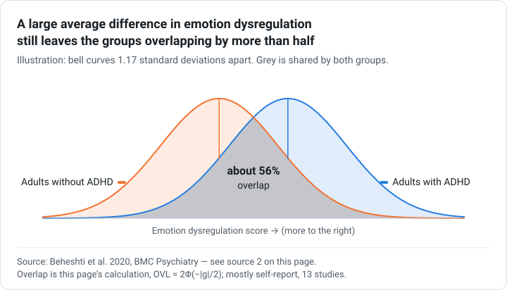

# Emotions and rejection in ADHD: why do they hit so hard?

> **Short answer:** Difficulty regulating emotions is common in ADHD, documented in children and, in fewer, mostly self-report studies, in adults. Some people with ADHD describe "rejection sensitive dysphoria" (RSD), intense pain at perceived rejection, but neither main diagnostic manual includes it, and no validated measure of it was found. The experience is real; RSD as a named condition is not established.

## What the evidence shows

**Emotion dysregulation is common in children with ADHD.** Emotion dysregulation means difficulty controlling how quickly, how strongly and for how long emotions are felt and expressed. An authoritative review reported that clinic-based studies estimate it affects 24–50% of children and teenagers with ADHD [1]. <!-- CHECK: 24–50% not in the PubMed abstract of Shaw 2014; confirm from the full text --> The authors argued it is best treated as a dimension, from mild to severe, and set out three competing explanations: that it is a core part of ADHD, a separate but related problem, or the mark of a distinct subgroup [1].

**Adults with ADHD report much more emotion dysregulation.** A meta-analysis of studies in adults found large differences from controls in emotion dysregulation overall (Hedges' *g* = 1.17) and emotional lability, meaning rapid shifts in mood (*g* = 1.20) [2]. The 13 studies were few and mostly used self-report questionnaires, so the size of the effect is uncertain [2].

**The two groups still overlap a lot.** At *g* = 1.17, the groups overlap by about 56% (this page's own calculation from the published effect size, not a figure from the paper). So many adults without ADHD score as high as many with it.

<picture>
  <source media="(prefers-color-scheme: dark)" srcset="../assets/charts/03/emotion-dysregulation-overlap-dark.svg">
  
</picture>

*An illustration of what g = 1.17 looks like, not real questionnaire data; it assumes bell-shaped scores with equal spread, and the effect size itself is uncertain because it rests on 13 mostly self-report studies.*

**A systematic review supports the same picture.** A 2023 review of 22 studies in adults with a clinical ADHD diagnosis found they used unhelpful emotion-regulation strategies more often than people without ADHD [3]. Emotion dysregulation was linked to symptom severity, executive difficulties and other psychiatric conditions. The authors described the evidence as scarce and heterogeneous [3].

**ADHD medicines reduce emotional lability, but less than core symptoms.** A meta-analysis of 9 placebo-controlled trials in adults found stimulants and atomoxetine reduced emotional lability by a moderate amount (SMD −0.41; a standardised mean difference, the gap between groups measured in units of how spread out people's scores are), about half the effect on core ADHD symptoms (SMD −0.8) [4]. The trials were not designed around emotional problems, and the authors called for studies that are [4]. Decisions about medication belong with a prescriber; more is on [how well medication works](../06-treatment-what-works/how-well-medication-works.md).

**Rejection sensitivity has some early evidence.** Rejection sensitivity is an established psychology concept: a tendency to anxiously expect, readily perceive and react strongly to rejection. In young adolescents, more ADHD symptoms were linked to stronger brain responses to peer rejection in a computer game, higher self-reported rejection sensitivity, and weaker brain responses to acceptance [5]. A 2024 study of college students, published as a conference abstract, found ADHD symptom scores were associated with scores on an adult rejection sensitivity questionnaire [6].

**Those studies measured rejection sensitivity, not RSD.** Both are single, correlational studies.

**RSD as a named condition is not established.** RSD is not in the DSM-5-TR or ICD-11, the two main diagnostic systems. The term was introduced by the US psychiatrist William Dodson, based on his clinical experience with people with ADHD, and spread widely through social media [7]. A search for this page, covering work published up to late 2026, found no validated questionnaire for RSD and no systematic review of RSD in ADHD.

**The first studies using the term are small.** A 2026 qualitative study of five university students with ADHD described masking, withdrawal and physical sensations as common responses to rejection [8]. A 2026 scoping review of rejection sensitivity dysphoria in *autistic* adults noted that the term is rarely used in scientific research [9]. A 2025 qualitative study of neurodivergent adults pointed to environmental factors, such as other people's judgement and learned responses to past rejection [10]; none of these tests RSD as a distinct condition.

## What is uncertain or debated

- **Is emotion dysregulation part of ADHD itself?** It is not one of the listed symptoms, as these pages' writers read the diagnostic criteria (the manual's text was not rechecked for this page). Experts disagree about whether it should be [1].
- **Is rejection sensitivity built in or learned?** People with ADHD often face more criticism and social rejection from childhood. Heightened sensitivity could come from ADHD itself, from that history, or both, and current studies cannot separate these.
- **Overlap with other conditions.** Intense emotions and rejection sensitivity are also features of anxiety, depression, trauma and borderline personality disorder. This is a reason for careful assessment; see [is it ADHD or something else](../05-what-often-comes-with-it/is-it-adhd-or-something-else.md).
- **Is a new label helpful?** A 2026 critical reflection by a Dutch researcher argued that RSD can offer validation and connection, but that using it between professionals risks more stigma, framing the experience as innate so that social and environmental causes are overlooked, confusing terms and outrunning the evidence [7]. It recommended the established idea of rejection sensitivity instead [7]. People who use the term and researchers largely agree on the experience; the disagreement is whether the label adds anything.
- **Treatment claims for RSD.** Popular sources sometimes recommend specific medicines for RSD. No trials of treatments for RSD as defined were found.

## What this means for you

If your emotions run hot and settle slowly, research on average supports that this is common in ADHD, and it is not a sign of weakness. If the term "rejection sensitive dysphoria" fits your experience, it is worth describing to a clinician in your own words. What is missing is research on RSD as a distinct condition, not recognition that people feel this way.

If emotional pain becomes overwhelming, help is available now; contacts are listed on [not medical advice and where to get help](../08-reading-this-well/not-medical-advice.md).

## Related pages

- [Anxiety and depression](../05-what-often-comes-with-it/anxiety-and-depression.md)
- [Will medication change me?](../06-treatment-what-works/will-medication-change-me.md)
- [When your partner has ADHD](../07-family-work-and-other-people/when-your-partner-has-adhd.md)
- [ADHD myths and corrections](../08-reading-this-well/myths-and-corrections.md)
- [Back to all worries](../README.md#find-your-worry)

## Sources

1. Shaw P, et al. Emotion dysregulation in attention deficit hyperactivity disorder. *American Journal of Psychiatry*. 2014;171(3):276–93. DOI 10.1176/appi.ajp.2013.13070966. PMID 24480998. — **Evidence: Strong**: authoritative review, mostly child and adolescent data.
2. Beheshti A, et al. Emotion dysregulation in adults with attention deficit hyperactivity disorder: a meta-analysis. *BMC Psychiatry*. 2020;20(1):120. DOI 10.1186/s12888-020-2442-7. PMID 32164655. — **Evidence: Moderate**: meta-analysis of 13 studies (2,535 participants), mostly self-report.
3. Soler-Gutiérrez AM, et al. Evidence of emotion dysregulation as a core symptom of adult ADHD: a systematic review. *PLOS ONE*. 2023;18(1):e0280131. DOI 10.1371/journal.pone.0280131. PMID 36608036. — **Evidence: Moderate**: systematic review of 22 heterogeneous studies.
4. Moukhtarian TR, et al. Effects of stimulants and atomoxetine on emotional lability in adults: a systematic review and meta-analysis. *European Psychiatry*. 2017;44:198–207. DOI 10.1016/j.eurpsy.2017.05.021. PMID 28646732. — **Evidence: Moderate**: 9 randomised placebo-controlled trials, lability a secondary outcome.
5. Babinski DE, et al. Sensitivity to peer feedback in young adolescents with symptoms of ADHD: examination of neurophysiological and self-report measures. *Journal of Abnormal Child Psychology*. 2019;47(4):605–17. DOI 10.1007/s10802-018-0470-2. PMID 30155685. — **Evidence: Limited**: single correlational study.
6. Müller V, Pikó B. From ADHD to well-being: the role of rejection sensitivity in college life. *European Psychiatry*. 2024;67(S1):S284–S285 (conference abstract). DOI 10.1192/j.eurpsy.2024.594. PMC11859226. — **Evidence: Limited**: single cross-sectional study.
7. van Asselt A. [Rejection sensitivity dysphoria: a critical reflection]. *Tijdschrift voor Psychiatrie*. 2026;68(3):127–30. PMID 41944472. — **Evidence: Expert commentary**: critical reflection in Dutch; the attribution of the term to Dodson was confirmed from the English abstract, not the full text.
8. Rowney-Smith A, et al. The lived experience of rejection sensitivity in ADHD: a qualitative exploration. *PLOS ONE*. 2026;21(1):e0314669. DOI 10.1371/journal.pone.0314669. PMID 41564005. — **Evidence: Limited**: qualitative focus group, five undergraduates.
9. van Asselt A, et al. Rejection sensitivity dysphoria in autistic adults: a scoping review. 2026. DOI 10.1177/27546330261441753. — **Evidence: Limited**: scoping review of a small, recent literature, autism not ADHD.
10. Sandland B. Neurodivergent experiences of rejection sensitive dysphoria expose the environmental factors too often overlooked. *Neurodiversity*. 2025. DOI 10.1177/27546330251394516. — **Evidence: Limited**: qualitative thematic analysis.

---
Last reviewed: November 2026 · [How these pages are made](../08-reading-this-well/sources-and-guidelines.md) · [Not medical advice](../08-reading-this-well/not-medical-advice.md)
