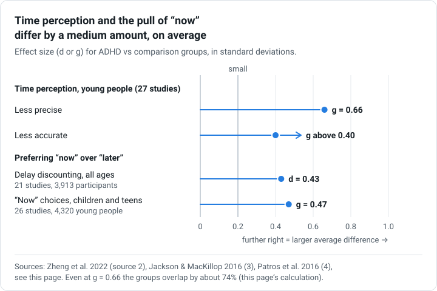

# Time and waiting in ADHD: why do I lose track and hate waiting?

> **Short answer:** On average, people with ADHD judge time less accurately and consistently, and more often choose a smaller reward now over a larger one later. Both findings are reliable across dozens of studies, with plenty of overlap between people with and without ADHD. "Time blindness" overstates the lab findings: time perception is less precise in ADHD, not absent.

## What the evidence shows

**Timing is less accurate across every type of task.** A meta-analysis of 55 studies compared people with and without ADHD on timing intervals from milliseconds to several seconds [1]. Tasks included telling which of two intervals is longer (discrimination), estimating a duration, producing one (for example "press when 5 seconds have passed"), and reproducing one. People with ADHD performed less well on all four types [1].

**Both distraction and impatience seem to play a part.** On reproduction tasks, errors were linked both to distraction during short intervals and to impatience during long ones [1]. Estimation and production errors pointed to an internal clock that runs fast [1]. The paper's abstract does not give effect sizes for each task type, so none are quoted here.

**Children and teenagers perceive time less accurately and less precisely.** A meta-analysis of 27 studies in young people found time perception was less accurate (*g* above 0.40) and less precise (*g* = 0.66), with a tendency to overestimate how much time has passed [2]. By this page's own calculation (not a figure from the paper), a *g* of 0.66 means the two groups' scores overlap by about 74%. These are findings in young people; fewer studies exist in adults.

**Preferring "now" over "later" is reliably stronger.** Delay discounting is the tendency to value a reward less the longer you have to wait for it. A meta-analysis of 21 studies (3,913 participants) found people with ADHD discounted delayed money more steeply than people without ADHD, by a medium amount (*d* = 0.43), with no difference between young people and adults [3]. The authors described the evidence as robust [3].

**A second meta-analysis in children agrees.** Across 26 studies of 4,320 children and teenagers, those with ADHD made more "now rather than later" choices, again by a medium amount (*g* = 0.47) [4]. Effects were larger in studies that diagnosed ADHD from a single informant and in studies that left out girls, which may mean some published figures are inflated [4].

<picture>
  <source media="(prefers-color-scheme: dark)" srcset="../assets/charts/03/time-and-reward-effect-sizes-dark.svg">
  
</picture>

*Medium-sized average differences from sources 2, 3 and 4; the delay-discounting studies used money choices in the lab, and the time-perception results are from young people only.*

**That matches distant deadlines feeling unreal.** In practice, steeper discounting fits the experience of a deadline seeming unreal until it is very close. This is an interpretation; the studies above used money choices in the lab, not real deadlines.

**Waiting itself can be aversive.** The "delay aversion" theory proposes that some people with ADHD find waiting unpleasant and act to escape it, for example by choosing the immediate option, or by filling the wait with other activity that looks like distractibility [5]. This is one of the two routes in the "dual pathway" model, the other being executive difficulties, which proposes they are separate routes into ADHD with different brain circuits [5]. More is on [why no two ADHD brains are alike](../02-whats-happening-in-my-brain/why-no-two-adhd-brains-are-alike.md).

**Reward-pathway biology fits, loosely.** An imaging study of never-medicated adults found lower dopamine markers in the brain's reward pathway, linked to inattention [6]. This is consistent with reward and motivation differences, but it is one study, and dopamine findings are inconsistent overall. See [dopamine, noradrenaline and the myths](../02-whats-happening-in-my-brain/dopamine-noradrenaline-and-myths.md).

## What is uncertain or debated

- **Lab seconds versus real-life hours.** Most timing studies measure intervals of seconds. Whether the same differences explain losing an afternoon, or chronic lateness, has not been directly shown.
- **Timing or attention?** Poor timing may partly reflect lapses of attention during the task rather than a separate "clock" problem. The reproduction findings above suggest both play a part [1].
- **Specificity.** Steep delay discounting is also found in addiction and some other conditions, so it is not unique to ADHD.
- **Whether the effect is inflated.** The children's meta-analysis found larger effects in studies with weaker diagnostic methods or no girls [4]. This is one reason to treat the exact sizes as approximate.
- **Discounting or dislike of waiting?** A 2021 meta-analysis of 37 comparisons (3,763 participants) found small-to-medium effects both on discounting tasks and on simpler choose-now-or-wait tasks, and offering real rather than imaginary rewards on the simpler tasks almost doubled the odds ratio for impulsive choice in ADHD [7]. Its authors read this as delay aversion combined with low motivation for imaginary rewards, rather than a fixed discounting trait [7].
- **"Time blindness"** is a popular metaphor, not a research term. It describes the experience usefully, but the evidence supports "less accurate and more variable", not "blind".
- **Individual differences.** These are group-level effects, and the groups overlap, so some people with ADHD time intervals as well as anyone.

## What this means for you

If deadlines only feel real at the last minute, or waiting is close to intolerable, research on average supports that these are features of ADHD, not laziness. The evidence describes groups, so your own timing could sit anywhere in a wide range.

External cues, such as visible clocks, timers and broken-down deadlines, are often suggested because they work around exactly this difficulty. Trials of specific timing strategies were not located for this page.

## Related pages

- [Executive function and ADHD: why can't I plan or get started?](executive-function-and-working-memory.md)
- [ADHD and hyperfocus: why can I focus for hours on some things?](attention-regulation-and-hyperfocus.md)
- [Is ADHD caused by low dopamine?](../02-whats-happening-in-my-brain/dopamine-noradrenaline-and-myths.md)
- [ADHD myths: which popular claims are wrong or half right?](../08-reading-this-well/myths-and-corrections.md)
- [Back to all worries](../README.md#find-your-worry)

## Sources

1. Marx I, et al. Meta-analysis: altered perceptual timing abilities in attention-deficit/hyperactivity disorder. *Journal of the American Academy of Child and Adolescent Psychiatry*. 2022;61(7):866–80. DOI 10.1016/j.jaac.2021.12.004. PMID 34923055. — **Evidence: Moderate**: meta-analysis of 55 studies; abstract gives no pooled effect sizes.
2. Zheng Q, et al. Time perception deficits in children and adolescents with ADHD: a meta-analysis. *Journal of Attention Disorders*. 2022;26(2):267–81 (online 2020). DOI 10.1177/1087054720978557. PMID 33302769. — **Evidence: Moderate**: meta-analysis of 27 studies (1,620 with ADHD, 1,249 controls), young people only.
3. Jackson JN, MacKillop J. Attention-deficit/hyperactivity disorder and monetary delay discounting: a meta-analysis of case-control studies. *Biological Psychiatry: Cognitive Neuroscience and Neuroimaging*. 2016;1(4):316–25. DOI 10.1016/j.bpsc.2016.01.007. PMID 27722208. — **Evidence: Strong**: meta-analysis of 21 studies (25 comparisons, 3,913 participants), minimal heterogeneity.
4. Patros CH, et al. Choice-impulsivity in children and adolescents with attention-deficit/hyperactivity disorder (ADHD): a meta-analytic review. *Clinical Psychology Review*. 2016;43:162–74. DOI 10.1016/j.cpr.2015.11.001. PMID 26602954. — **Evidence: Moderate**: meta-analysis of 26 studies (4,320 children); effect varies with diagnostic method.
5. Sonuga-Barke EJS. The dual pathway model of AD/HD: an elaboration of neuro-developmental characteristics. *Neuroscience and Biobehavioral Reviews*. 2003;27(7):593–604. DOI 10.1016/j.neubiorev.2003.08.005. PMID 14624804. — **Evidence: Expert review**: theoretical paper describing the model, not testing it.
6. Volkow ND, et al. Evaluating dopamine reward pathway in ADHD: clinical implications. *JAMA*. 2009;302(10):1084–91. DOI 10.1001/jama.2009.1308. PMID 19738093. — **Evidence: Limited**: one PET study, 53 never-medicated adults with ADHD and 44 controls, single site.
7. Marx I, et al. ADHD and the choice of small immediate over larger delayed rewards: a comparative meta-analysis of performance on simple choice-delay and temporal discounting paradigms. *Journal of Attention Disorders*. 2021;25(2):171–87. DOI 10.1177/1087054718772138. PMID 29806533. — **Evidence: Moderate**: meta-analysis of 37 group comparisons.

---
Last reviewed: November 2026 · [How these pages are made](../08-reading-this-well/sources-and-guidelines.md) · [Not medical advice](../08-reading-this-well/not-medical-advice.md)
