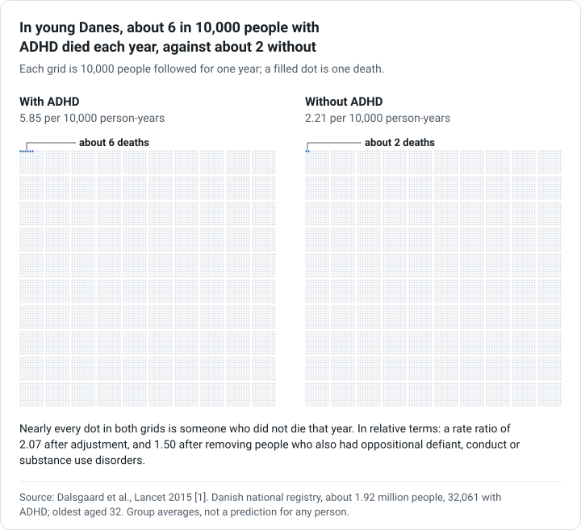
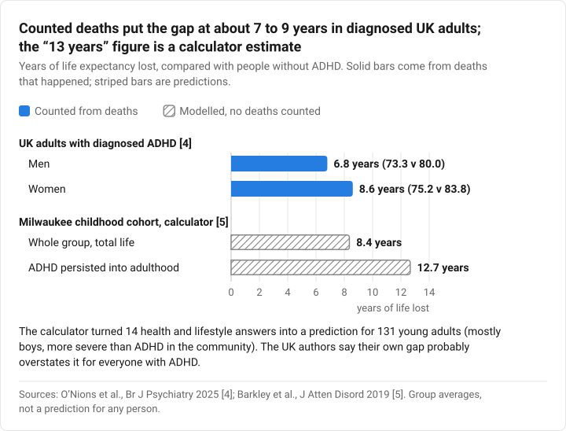

# Will ADHD shorten my life? The hard statistics in context

> **Short answer:** On average, people diagnosed with ADHD die younger. In young Danes, about 6 in 10,000 with ADHD died each year, against 2 without; accidents were the commonest cause. The "13 years" figure is a calculator estimate. A UK study that counted deaths found life expectancy 7 to 9 years shorter in diagnosed adults, probably more than for everyone with ADHD.

This page discusses death, including suicide, and the short answer above is the main point. It is fine to stop reading and come back later. If you are struggling or thinking about ending your life, contacts that are open now are on [not medical advice and where to get help](../08-reading-this-well/not-medical-advice.md).

## What the evidence shows

**Relative and absolute risk say different things.** A relative risk says how many times more common something is in one group than another; an absolute risk says how many people out of a given number it actually happens to. "Twice the risk" sounds the same whether the starting risk is 1 in 10 or 1 in 10,000. Absolute figures are given below wherever a study reported one; more is on [how to read the evidence](../08-reading-this-well/how-to-read-the-evidence.md).

**Death rates: about twice as high, but small in absolute terms.** A Danish study of about 1.92 million people, including 32,061 with ADHD, found people with ADHD died at a rate of 5.85 per 10,000 person-years (one person followed for one year), against 2.21 for people without ADHD [1]. That is about 6 deaths against about 2 among 10,000 people in a year, a rate ratio of 2.07 after adjustment [1].

<picture>
  <source media="(prefers-color-scheme: dark)" srcset="../assets/charts/04/deaths-per-10000-dark.svg">
  
</picture>

*Danish death rates with and without ADHD, shown out of 10,000 people a year; the cohort was aged 32 or under, so this mostly describes deaths in childhood and early adulthood. Support contacts are on [not medical advice](../08-reading-this-well/not-medical-advice.md).*

Accidents were the most common cause: of 79 deaths with a known cause, 54 were from unnatural causes, 42 of them accidents [1]. The cohort was young (the oldest were 32 at the end of follow-up, a calculation from the birth years), so this mostly describes deaths in childhood and early adulthood.

**Much of the Danish excess sits with other conditions.** When the researchers removed people who also had oppositional defiant disorder, conduct disorder or a substance use disorder, the rate ratio fell from 2.07 to 1.50 [1]. The excess was larger in people diagnosed as adults, and larger in girls and women than in boys and men [1].

After those exclusions the rate ratio was 2.85 for girls and women and 1.27 for boys and men, and the range of uncertainty for boys and men included no difference at all [1].

**Pooled studies agree on the direction.** A 2026 meta-analysis (a study that combines the results of earlier studies) of 19 studies covering about 16 million people found a hazard ratio of 1.71 for death from any cause, meaning a rate about 70% higher [2]. Death from suicide was about 90% higher, death from injury about 55% higher, and death from natural causes about 27% higher, though the natural-cause figure rests on only three studies [2].

A 2022 meta-analysis found a similar result (a relative risk of 2.13, 8 studies) with a wide margin of uncertainty [3]. Neither paper's abstract gave a pooled absolute risk.

**Life expectancy: about 7 to 9 years shorter, in diagnosed adults.** A UK study of 30,039 adults with an ADHD diagnosis in GP records from 2000 to 2019 estimated life expectancy at 73.3 years for men with ADHD against 80.0 for comparison men (6.8 years less), and 75.2 against 83.8 for women (8.6 years less) [4]. This is the best measured estimate: it was built from deaths that actually happened, converted into life expectancy using standard life tables.

The authors say the gap probably overstates the gap for everyone with ADHD, because most adults with ADHD in the UK are undiagnosed, and the people who do get a diagnosis may not be typical of everyone with ADHD. They also say the gap is unlikely to be caused by ADHD itself [4].

**The "13 years" figure is modelled, not measured.** It is a calculator estimate from a Milwaukee cohort of children diagnosed with hyperactivity in 1978–80, of whom 131 (with 71 controls) were reassessed at an average age of 27; no deaths were counted [5]. The paper's abstract gives an estimated 9.5 fewer years of healthy life and 8.4 fewer years of total life for the childhood group, and a 12.7-year reduction for those whose ADHD persisted into adulthood [5]. The lead author's summaries describe the persistent group's figures as 12.7 healthy and 11.1 total years; the 11.1 figure is not in the abstract.

It is a clinical sample of mostly boys, more severe than ADHD in the community, and it measures risk factors, which can change.

<picture>
  <source media="(prefers-color-scheme: dark)" srcset="../assets/charts/04/life-expectancy-counted-vs-modelled-dark.svg">
  
</picture>

*Years of life lost as counted in the UK study and as predicted by a calculator in the Milwaukee cohort; both come from diagnosed or clinic groups, which are probably more severely affected than everyone with ADHD. Support contacts are on [not medical advice](../08-reading-this-well/not-medical-advice.md).*

**Road crashes are moderately more common.** A meta-analysis of 16 studies found drivers with ADHD had about 1.36 times the crash risk, or 1.23 after accounting for how much people drive, with some evidence that the excess was larger in drivers who also had conduct problems [6].

In US insurance data on 2.3 million people with ADHD, crash-related emergency visits were about 1.5 times as common as in matched people without ADHD (odds ratios 1.49 for men and 1.44 for women) [7]. In absolute terms, about 0.5% of the people with ADHD had at least one such visit during follow-up [7].

**Injuries in children: about 1.5 times the odds.** Children and teenagers with ADHD had about 1.5 times the odds of unintentional injury [8]. No absolute injury rate was given in the abstracts checked.

**Suicide risk is raised, and it is still uncommon.** The largest and most recent estimate, from the 2026 meta-analysis of 19 studies, is that death by suicide was about 90% more common in people with ADHD [2]. A 2019 meta-analysis gave a much higher figure for suicide deaths, an odds ratio of 6.7, but from only four datasets and with a very wide range of uncertainty (3.24 to 17.39) [9]. The difference probably reflects the older figure resting on few, smaller studies of mixed design, so the newer, larger estimate is the more reliable guide.

The 2019 review also found suicide attempts were about 2.4 times as likely in people with ADHD, across 44 datasets [9]. Absolute figures for suicide attempts or suicide deaths in people with ADHD were not found in the sources checked for this page.

If this paragraph is about you or someone close to you, the crisis contacts on [not medical advice and where to get help](../08-reading-this-well/not-medical-advice.md) are there for exactly this.

**Dementia: a registry link whose size is disputed.** In an Israeli health-insurance cohort of 109,218 people born 1933–52, dementia was diagnosed in 13.2% of the 730 people with adult ADHD and 7.0% of those without, over up to 17 years (adjusted hazard ratio 2.77) [10]. No clear increase was seen in those prescribed stimulants [10].

A Swedish study of 3.6 million people born 1932–63 found a hazard ratio of 2.92 (adjusted only for sex and birth year), and the risk weakened considerably once depression, anxiety, substance use disorder and bipolar disorder were taken into account, to a hazard ratio of 1.62 [11]. No absolute dementia rates were given in the abstract. A 2023 systematic review judged the evidence too varied to combine [12].

**Newer studies point to a larger link.** A 2026 meta-analysis of four cohort studies and one case–control study pooled a hazard ratio of 2.52 for dementia from any cause [13]. Its cohorts total about 3.7 million people, so they probably include the Swedish and Israeli studies above, and it summarises them more than it adds new data [13]. <!-- CHECK: which cohorts the 2026 meta-analysis pooled -->

In 187,341 US adults aged 50 and over, followed for about 10 years on average, cognitive impairment (mild cognitive impairment or dementia) was diagnosed in 6.7% of those with ADHD against 3.4% of those without (hazard ratio 4.60) [14]. Further adjustment for other health conditions, education and use of health care weakened the link but did not remove it [14]. A higher genetic risk score for ADHD also went with more cognitive impairment (hazard ratio 1.35, highest against lowest fifth), which is less open to the worry that early dementia was mislabelled as ADHD [14].

How the Danish and "13 years" studies were done (1 min)

The Danish study followed everyone born in Denmark from 1981 to 2011 from their first birthday to 2013 [1].

For the "13 years" estimate, according to the lead author's own account, the researchers entered 14 health and lifestyle answers into an online actuarial life-expectancy calculator from the University of Connecticut [5]. The result is a prediction from those answers, not an observation of when anyone died.

### Which risks can change

Several findings point to modifiable risks rather than fixed fate. The Danish excess shrank by about half once co-occurring conduct and substance use disorders were removed [1]. The UK authors attribute the gap to unmet support and treatment needs and to modifiable risk factors, and call for action on them [4].

**Treatment is associated with lower risk, with limits.** In Sweden, people who started ADHD medication had a two-year death risk of 39.1 per 10,000, against 48.1 per 10,000 for those who did not: about 9 fewer deaths per 10,000 people (this page's subtraction from the two published figures) [15]. The drop was in unnatural causes such as injuries and poisoning, not natural causes, and was weaker at five years [15].

Suicidal behaviour was also less frequent after starting medication (14.5 against 16.9 events per 1,000 person-years) [16]. These are observational studies, so they show association, not proof. Decisions about medication are for you and a prescriber, and the design details are on [what registries show about medication](../06-treatment-what-works/what-registries-show.md).

## What is uncertain or debated

- **Who is counted.** Nearly every study counts *diagnosed* people. Diagnosed people tend to have more severe ADHD and more co-occurring conditions, so the gap for everyone with ADHD is probably smaller. By how much is unknown.
- **Cause.** No study can separate ADHD itself from the things that travel with it: other diagnoses, smoking, poverty, being excluded from school or work. Causes of death were not available in the UK study [4].
- **Dementia direction and size.** Memory and attention problems that first appear late in life can be early dementia mislabelled as ADHD. The Israeli study found some evidence of this reverse direction, described as mild [10]. Estimates range from a hazard ratio of 1.62 once other psychiatric conditions are accounted for [11] to 4.60 for the broader outcome of any cognitive impairment [14], partly because studies differ on whether those conditions are confounders or steps on the path from ADHD.
- **Dementia in families.** Some of the Swedish link also runs in families: parents of people with ADHD had a higher dementia risk, though the researchers note the absolute risk was low: only 0.17% of the parents were diagnosed with dementia [17].
- **Time and place.** The data come from Denmark, Sweden, the UK, the US and Israel, mostly from particular decades. Health care and diagnosis rates differ.
- **Medication findings** rest on few studies. The 2026 meta-analysis found a lower death rate in people taking medication, but this rested on only 3 of its 19 studies, and the size of that estimate was seen only in press coverage, so it is not quoted here [2]. Observational findings like this cannot show that medication itself reduces deaths.

## What this means for you

These are averages across thousands of people, and they cannot predict any one person's life. The extra risk is concentrated in accidents, injury, suicide, substance use and untreated co-occurring conditions, and the evidence suggests several of these can change. The 6.8 and 8.6 year figures are the best measured estimates for diagnosed adults in the UK, with the authors' own warning that they probably overstate the gap.

## Related pages

- [Real-life outcomes on ADHD medication: what do registries show?](../06-treatment-what-works/what-registries-show.md)
- [Addiction and ADHD: is risk higher, and do medicines raise it?](../05-what-often-comes-with-it/alcohol-drugs-and-addiction.md)
- [ADHD over a lifetime: will it get better or worse as I age?](how-adhd-changes-over-life.md)
- [Can these pages tell me what to do about my ADHD?](../08-reading-this-well/not-medical-advice.md) (includes where to get help now)
- [Back to all worries](../README.md#find-your-worry)

## Sources

1. Dalsgaard S, et al. Mortality in children, adolescents, and adults with attention deficit hyperactivity disorder: a nationwide cohort study. *Lancet*. 2015. DOI 10.1016/S0140-6736(14)61684-6. PMID 25726514. — **Evidence: Strong**, national registry cohort, but young cohort and diagnosed cases only.
2. Corrigan L, et al. Mortality among people with attention-deficit/hyperactivity disorder: a systematic review and meta-analysis. *JAMA Netw Open*. 2026;9(10):e2639448. DOI 10.1001/jamanetworkopen.2026.39448. PMID 42895743. — **Evidence: Moderate**, 19 observational studies with substantial heterogeneity; the medication figure rests on 3 studies.
3. Catalá-López F, et al. Mortality in persons with autism spectrum disorder or attention-deficit/hyperactivity disorder: a systematic review and meta-analysis. *JAMA Pediatr*. 2022;176(4):e216401. DOI 10.1001/jamapediatrics.2021.6401. PMID 35157020. — **Evidence: Moderate**, meta-analysis; ADHD estimate from 8 studies with a wide confidence interval (1.13 to 4.02).
4. O'Nions E, et al. Life expectancy and years of life lost for adults with diagnosed ADHD in the UK: matched cohort study. *Br J Psychiatry*. 2025;226(5):261–8. DOI 10.1192/bjp.2024.199. PMID 39844532. — **Evidence: Moderate**, large primary-care cohort, diagnosed adults only, no cause-of-death data.
5. Barkley RA, et al. Hyperactive child syndrome and estimated life expectancy at young adult follow-up: the role of ADHD persistence and other potential predictors. *J Atten Disord*. 2019;23(9):907–23. DOI 10.1177/1087054718816164. PMID 30526189. — **Evidence: Limited**, actuarial calculator estimate in one clinical cohort (131 followed-up cases, 71 controls); no deaths observed.
6. Vaa T. ADHD and relative risk of accidents in road traffic: a meta-analysis. *Accid Anal Prev*. 2014;62:415–25. DOI 10.1016/j.aap.2013.10.003. PMID 24238842. — **Evidence: Moderate**, meta-analysis of 16 studies with exposure and publication-bias adjustment.
7. Chang Z, et al. Association between medication use for attention-deficit/hyperactivity disorder and risk of motor vehicle crashes. *JAMA Psychiatry*. 2017;74(6):597–603. DOI 10.1001/jamapsychiatry.2017.0659. PMID 28492937. PMC5539840. — **Evidence: Strong**, 2.3 million people, within-person design for the medication comparison.
8. Ruiz-Goikoetxea M, et al. Risk of unintentional injuries in children and adolescents with ADHD and the impact of ADHD medications: a systematic review and meta-analysis. *Neurosci Biobehav Rev*. 2018;84:63–71. DOI 10.1016/j.neubiorev.2017.11.007. PMID 29162520. — **Evidence: Moderate**, meta-analysis of 28 studies (pooled odds ratio 1.53), children and adolescents.
9. Septier M, et al. Association between suicidal spectrum behaviors and attention-deficit/hyperactivity disorder: a systematic review and meta-analysis. *Neurosci Biobehav Rev*. 2019;103:109–18. DOI 10.1016/j.neubiorev.2019.05.022. PMID 31129238. — **Evidence: Moderate** for attempts (44 datasets), **Limited** for deaths (4 datasets, very wide interval).
10. Levine SZ, et al. Adult attention-deficit/hyperactivity disorder and the risk of dementia. *JAMA Netw Open*. 2023;6(10):e2338088. DOI 10.1001/jamanetworkopen.2023.38088. PMID 37847497. — **Evidence: Limited**, single observational cohort with 730 exposed people.
11. Dobrosavljevic M, et al. Attention-deficit/hyperactivity disorder as a risk factor for dementia and mild cognitive impairment: a population-based register study. *Eur Psychiatry*. 2022;65(1):e3. PMID 34924079. — **Evidence: Moderate**, national registry, association largely explained by psychiatric conditions.
12. Becker S, et al. Risk of neurodegenerative disease or dementia in adults with attention-deficit/hyperactivity disorder: a systematic review. *Front Psychiatry*. 2023;14:1158546. DOI 10.3389/fpsyt.2023.1158546. PMID 37663597. — **Evidence: Limited**, narrative synthesis of 7 studies, no pooling possible.
13. Baiamonte L, et al. Attention deficit/hyperactivity disorder and risk of dementia: a systematic review and meta-analysis. *Brain Sci*. 2026;16(6):646. DOI 10.3390/brainsci16060646. PMID 42352655. — **Evidence: Moderate**, meta-analysis of only five studies, likely overlapping with those cited above.
14. Bauer-Negrini G, et al. Attention-deficit/hyperactivity disorder and late-life cognitive impairment. *JAMA Psychiatry*. 2026. DOI 10.1001/jamapsychiatry.2026.3165. PMID 42842281. — **Evidence: Moderate**, US cohort of 187,341 adults aged 50 and over (3,026 with ADHD) with health records and genetic scores; outcome includes mild cognitive impairment.
15. Li L, et al. ADHD pharmacotherapy and mortality in individuals with ADHD. *JAMA*. 2024;331(10):850–60. DOI 10.1001/jama.2024.0851. PMID 38470385. — **Evidence: Moderate**, target-trial emulation in 148,578 people, observational.
16. Zhang L, et al. ADHD drug treatment and risk of suicidal behaviours, substance misuse, accidental injuries, transport accidents, and criminality: emulation of target trials. *BMJ*. 2025;390:e083658. DOI 10.1136/bmj-2024-083658. PMID 40803836. — **Evidence: Moderate**, national registry, observational; a published correction relabels figure 2.
17. Zhang L, et al. Attention-deficit/hyperactivity disorder and Alzheimer's disease and any dementia: a multi-generation cohort study in Sweden. *Alzheimers Dement*. 2022;18(6):1155–63. DOI 10.1002/alz.12462. PMID 34498801. — **Evidence: Moderate**, multi-generation registry; published online 2021.

---
Last reviewed: November 2026 · [How these pages are made](../08-reading-this-well/sources-and-guidelines.md) · [Not medical advice](../08-reading-this-well/not-medical-advice.md)
