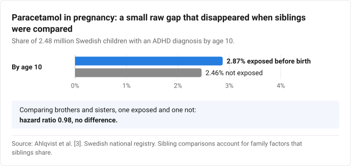

# What causes ADHD, and is it my fault or my parents'?

> **Short answer:** Parenting style and sugar do not appear to cause ADHD, and links with paracetamol, smoking and light drinking in pregnancy mostly shrink or disappear when siblings are compared. Differences between people mostly track inherited genes. Very early birth is the clearest exception, as its link largely survives sibling comparison. Screen links are small and partly genetic; cause is unproven.

## What the evidence shows

**Sibling comparisons help separate causes from coincidences.** Many things are more common in families where a child has ADHD, but that does not make them causes. A mother with ADHD traits passes on genes, and she may also be more likely to smoke; this mixing is called *confounding*.

A sibling comparison (or sibling-control design) compares brothers and sisters born to the same mother, where she smoked or took a medicine in one pregnancy and not in the other. If the exposed sibling is no more likely to have ADHD than the unexposed one, the original link was probably about the family, not the exposure. If the link stays, the exposure is more likely to matter.

Why comparing siblings helps (1 min)

Any study that simply compares smokers' children with non-smokers' children mixes genes and exposure together. Siblings share the same mother, much of the same genes and the same home, so comparing them removes much of that mixing. More detail is on [how to read the evidence](../08-reading-this-well/how-to-read-the-evidence.md).

**Genes explain most of the variation between people.** Twin studies put heritability, a population statistic about how much of the *variation* in ADHD traits tracks genetic differences, at about 74% on average [1]. Heritability does not mean fixed or unchangeable; the full numbers and what they can and cannot say are on [genes and inheritance](../02-whats-happening-in-my-brain/genes-and-inheritance.md).

**Smoking in pregnancy: the link is mostly about families.** In Swedish registry data, children whose mothers smoked in pregnancy were more likely to be diagnosed with ADHD (hazard ratios of 1.89 for moderate and 2.50 for heavy smoking) [2]. Among siblings, the link disappeared (0.88 and 0.84). Comparing cousins, who share fewer genes, gave in-between results (1.45 and 1.69) [2].

That pattern, strongest in unrelated people and weakest in siblings, is what shared family factors would produce. It does not make smoking in pregnancy safe, because smoking harms pregnancies in other ways.

**Fathers' smoking points the same way.** An umbrella review of six meta-analyses found raised odds of ADHD in children when mothers smoked in pregnancy (odds ratio 1.71), but also when fathers did (1.36), which is hard to explain by a direct effect in the womb; absolute risks were not given [3]. In three European pregnancy cohorts, mothers' smoking was weakly linked with children's ADHD symptoms and fathers' was not, but the mothers' link did not survive checks such as allowing for the mothers' own ADHD symptoms, and the authors concluded there appears to be no causal effect in the womb [4]. One genetic (Mendelian randomisation) study reported a causal effect, but a published comment judged its evidence inconclusive [5], [6].

**Paracetamol in pregnancy: no link within families in the largest studies.** Among 2.48 million Swedish children, 2.87% of those exposed to paracetamol before birth had an ADHD diagnosis by age 10, against 2.46% of those not exposed [7]. In sibling comparisons the hazard ratio was 0.98, meaning no difference [7].

<picture>
  <source media="(prefers-color-scheme: dark)" srcset="../assets/charts/04/paracetamol-siblings-dark.svg">
  
</picture>

*The share of Swedish children diagnosed with ADHD by age 10 by paracetamol exposure before birth, with the sibling comparison beside it; the raw percentages do not account for family factors, which is why the sibling result matters.*

A 2025 umbrella review in the *BMJ* found that earlier reviews reporting a link were of low to critically low quality, and that in the two sibling-controlled studies included, the small raised risk of ADHD seen in whole groups disappeared [8]. A 2026 meta-analysis using only sibling-comparison studies found no association (odds ratio 0.95) [9]. <!-- CHECK: OR 0.95 and '17 of 43 studies' not visible in any index record reached (no abstract in PubMed/Crossref/Europe PMC); confirm from the paper -->

**One review read the evidence the other way.** A 2025 review of 46 studies using the Navigation Guide method, which rates study quality without giving sibling designs special weight, found that 27 reported links, judged higher-quality studies more likely to find them, and called for advising pregnant women to limit use [10]. One of its authors declared work as an expert witness for plaintiffs in legal cases on this question [10]. The main argument on that side is that sibling designs are biased towards finding no effect when exposure is recorded poorly, which could hide a small or dose-related effect.

**The US label process, as of late 2026.** In September 2025 the US Food and Drug Administration (FDA) wrote to doctors and said it had started the process of changing paracetamol's label to mention a possible association between use in pregnancy and autism and ADHD; in the same notice it said a causal relationship had not been established [11]. As of late 2026, news reports said the label had not yet changed and the FDA had not given an update; this may change after this page was checked. The *BMJ* review and the sibling meta-analysis above were published after that announcement.

Decisions about any medicine in pregnancy are for you and your clinician; more is on [pregnancy and breastfeeding](../06-treatment-what-works/pregnancy-and-breastfeeding.md).

**Parenting: the arrow often runs from child to parent.** Adoption studies can separate a parent's genes from their parenting, because adopted children do not share their adoptive parents' genes. In one, the birth mother's ADHD symptoms predicted the child's early impulsivity, which predicted harsher parenting by the adoptive mother, which then predicted the child's later ADHD symptoms [12]. In other words, a child's ADHD traits can draw out harsher parenting.

Parenting still matters a great deal for how a child gets on, which is covered on [parenting and what helps](../07-family-work-and-other-people/parenting-and-what-helps.md).

**Sugar: no effect in blinded trials.** A 1995 meta-analysis of double-blind trials, in which neither children, parents nor research staff knew who had sugar, found no effect on behaviour or thinking [13]. The authors said a small effect, or an effect in a small subgroup, could not be ruled out [13]. Parents' expectations seem to shape what they see.

Food colours and elimination diets are a separate question, with small effects in some children who already have ADHD, covered on [lifestyle and other approaches](../06-treatment-what-works/lifestyle-and-other-approaches.md).

**Screens: a small link, partly genetic, and cause is unproven.** In a US study of 2,587 teenagers without significant ADHD symptoms at the start, 9.5% of those using seven kinds of digital media at high frequency had ADHD symptoms over about two years of follow-up, against 4.6% of those with no high-frequency use [14]. Each extra high-frequency activity raised the odds by about 11% [14].

The authors called the link modest and said it does not show cause. Teenagers developing attention problems may also be drawn to more screen use.

**Larger reviews find small effects running both ways.** A meta-analysis of 87 studies (159,425 children aged 12 or under) found only a small correlation between screen time and behaviour problems that include ADHD symptoms (*r* = 0.11) [15]. A review of 28 longitudinal studies found links in both directions, clearer for problematic use than for screen time itself: children with ADHD symptoms seem more drawn to heavy or problematic use, and media use may also affect later symptoms, perhaps partly through sleep [16]. In 4,262 US children, shared genetic risk accounted for most of the link between screen time and attention problems [17].

**Alcohol in pregnancy: heavy and light drinking are different questions.** Heavy drinking in pregnancy can cause fetal alcohol spectrum disorder (FASD), and in a meta-analysis of 57 studies of people exposed to alcohol before birth, ADHD was among the most common co-occurring diagnoses [18]. For the lighter drinking most pregnant drinkers report, a Norwegian study of 114,247 children found a very weak link with mothers' ratings of ADHD symptoms after sibling and other comparisons, and none with an ADHD diagnosis [19]; the three-cohort study above found no causal effect on symptoms [4]. This does not make drinking in pregnancy safe, and drinking in pregnancy tends to be under-reported, which pushes such estimates towards no effect.

**Very preterm birth: a consistent risk factor.** Across 12 studies, children born very or extremely preterm, or at very or extremely low birth weight, had about three times the odds of an ADHD diagnosis (odds ratio 3.04) [20]. The authors report that the link was stronger for those born extremely early or extremely small [20]. Absolute rates were not reported in the abstract.

**Unlike the other exposures here, the preterm link survives sibling comparison.** In a Norwegian study of 113,227 children, including 33,081 siblings, children born early preterm (before 34 weeks) scored about a quarter of a standard deviation higher on ADHD symptoms than siblings born at 40 weeks (0.24), with a larger gap for inattention (0.33) [21]. A systematic review of 140 twin and sibling studies likewise listed low birth weight and gestational age among the few early factors still linked to ADHD after family factors were accounted for [22]. These effects are modest and were measured as symptom scores, not diagnoses, so the absolute difference in diagnosis is not known from these studies.

## What is uncertain or debated

- **The non-genetic part is largely unexplained.** Heritability below 100% leaves room for other factors, but most of them have not been identified with confidence.
- **Sibling designs have weak spots.** Siblings still differ in ways a study cannot see, such as why a mother smoked in one pregnancy and not the other. Errors in recording exposures push sibling estimates towards no effect, which could hide a small real one.
- **Genes and environment interact.** Genetic risk can shape which environments a child meets, as the adoption study shows, and the two are hard to pull apart.
- **Screens and very early birth** need better causal designs before anyone can say how much they add. For screens, two genetic (Mendelian randomisation) studies reached opposite conclusions, one finding that a genetic tendency to more phone and television time raised childhood ADHD risk and the other that more leisure screen time went with lower risk [23], [24], which suggests the method does not yet give clear answers here.
- **Extreme deprivation is an exception, not ordinary parenting.** Romanian children adopted into UK families after more than six months in severely depriving orphanages were over seven times as likely to meet ADHD criteria as young adults (29.3% against 3.8%) [25]. That was global neglect far outside normal family life, and the resulting ADHD was unusual, mostly inattentive and often with autistic features [25]; it says nothing about ordinary parenting.

## What this means for you

The evidence does not support the idea that a parent caused ADHD through how they raised a child, through sugar, or through taking paracetamol in pregnancy. The family link that does exist is mostly inheritance, which nobody chooses. How a family responds to ADHD can make a real difference to how life goes, and that is a different question from where ADHD came from.

## Related pages

- [Genes and inheritance](../02-whats-happening-in-my-brain/genes-and-inheritance.md)
- [How to read the evidence](../08-reading-this-well/how-to-read-the-evidence.md)
- [Parenting and what helps](../07-family-work-and-other-people/parenting-and-what-helps.md)
- [Pregnancy and breastfeeding](../06-treatment-what-works/pregnancy-and-breastfeeding.md)
- [Back to all worries](../README.md#find-your-worry)

## Sources

1. Faraone SV, Larsson H. Genetics of attention deficit hyperactivity disorder. *Mol Psychiatry*. 2019;24(4):562–75. DOI 10.1038/s41380-018-0070-0. PMID 29892054. — **Evidence: Strong**, review of 37 twin studies.
2. Skoglund C, et al. Familial confounding of the association between maternal smoking during pregnancy and ADHD in offspring. *J Child Psychol Psychiatry*. 2014;55(1):61–8. DOI 10.1111/jcpp.12124. PMID 25359172. — **Evidence: Strong**, national registry with sibling and cousin comparisons.
3. Tsegay L, et al. Maternal and paternal smoking during pregnancy and the risk of ADHD in offspring: an umbrella review of systematic reviews and meta-analyses. *J Psychiatr Res*. 2026;193:441–6. DOI 10.1016/j.jpsychires.2025.12.010. PMID 41385914. — **Evidence: Moderate**, umbrella review of six meta-analyses of observational studies (about 2.2 million people for maternal smoking).
4. Haan E, et al. Prenatal smoking, alcohol and caffeine exposure and maternal-reported attention deficit hyperactivity disorder symptoms in childhood: triangulation of evidence using negative control and polygenic risk score analyses. *Addiction*. 2022;117(5):1458–71. DOI 10.1111/add.15746. PMID 34791750. — **Evidence: Moderate**, three pregnancy cohorts (ALSPAC, Generation R, MoBa) with fathers as a comparison; symptoms rated by mothers.
5. Xie T, et al. The causal impact of maternal smoking around birth on offspring ADHD: a two-sample Mendelian randomization study. *J Affect Disord*. 2024;351:24–30. DOI 10.1016/j.jad.2024.01.196. PMID 38266926. — **Evidence: Contested**, genetic analysis of summary data (odds ratio 2.54); its genetic markers may also reflect the child's own inherited risk.
6. Sorjonen K, et al. Inconclusive evidence for a causal impact of maternal smoking on offspring ADHD in a Mendelian randomization study by Xie and Mao (2024). *J Affect Disord*. 2024;355:104–5. DOI 10.1016/j.jad.2024.03.140. PMID 38554877. — **Evidence: Commentary**, published critique; no abstract, so its arguments were not checked.
7. Ahlqvist VH, et al. Acetaminophen use during pregnancy and children's risk of autism, ADHD, and intellectual disability. *JAMA*. 2024;331(14):1205–14. DOI 10.1001/jama.2024.3172. PMID 38592388. — **Evidence: Strong**, 2.48 million children with full-sibling comparison.
8. Sheikh J, et al. Maternal paracetamol (acetaminophen) use during pregnancy and risk of autism spectrum disorder and attention deficit/hyperactivity disorder in offspring: umbrella review of systematic reviews. *BMJ*. 2025;391:e088141. DOI 10.1136/bmj-2025-088141. PMID 41207796. — **Evidence: Moderate**, umbrella review of 9 reviews (40 studies); confidence in the reviews' findings rated low (2) or critically low (7).
9. D'Antonio F, et al. Prenatal paracetamol exposure and child neurodevelopment: a systematic review and meta-analysis. *Lancet Obstetrics, Gynaecology, & Women's Health*. 2026;2(3):e190–8. DOI 10.1016/S3050-5038(25)00211-0. — **Evidence: Strong**, meta-analysis restricted to sibling-comparison studies (17 of 43 studies pooled); published online January 2026.
10. Prada D, et al. Evaluation of the evidence on acetaminophen use and neurodevelopmental disorders using the Navigation Guide methodology. *Environ Health*. 2025;24(1):56. DOI 10.1186/s12940-025-01208-0. PMID 40804730. — **Evidence: Contested**, qualitative systematic review of 46 studies without pooling or special weight for sibling designs; an author declared expert-witness work for plaintiffs.
11. US Food and Drug Administration. FDA responds to evidence of possible association between autism and acetaminophen use during pregnancy. FDA notice and letter to physicians, 22 September 2025. — **Evidence: Regulatory notice**, not a study; states that a causal relationship has not been established.
12. Harold GT, et al. Biological and rearing mother influences on child ADHD symptoms: revisiting the developmental interface between nature and nurture. *J Child Psychol Psychiatry*. 2013;54(10):1038–46. DOI 10.1111/jcpp.12100. PMID 24007415. — **Evidence: Moderate**, two adoption samples, path models.
13. Wolraich ML, et al. The effect of sugar on behavior or cognition in children: a meta-analysis. *JAMA*. 1995;274(20):1617–21. DOI 10.1001/jama.1995.03530200053037. PMID 7474248. — **Evidence: Moderate**, meta-analysis of 23 blinded, placebo-controlled within-person studies (16 reports), older and small.
14. Ra CK, et al. Association of digital media use with subsequent symptoms of attention-deficit/hyperactivity disorder among adolescents. *JAMA*. 2018;320(3):255–63. DOI 10.1001/jama.2018.8931. PMID 30027248. — **Evidence: Limited**, single observational cohort, self-reported symptoms.
15. Eirich R, et al. Association of screen time with internalizing and externalizing behavior problems in children 12 years or younger: a systematic review and meta-analysis. *JAMA Psychiatry*. 2022;79(5):393–405. DOI 10.1001/jamapsychiatry.2022.0155. PMID 35293954. — **Evidence: Strong**, meta-analysis of 87 studies, 159,425 children; high heterogeneity, mostly observational.
16. Thorell LB, et al. Longitudinal associations between digital media use and ADHD symptoms in children and adolescents: a systematic literature review. *Eur Child Adolesc Psychiatry*. 2024;33(8):2503–26. DOI 10.1007/s00787-022-02130-3. PMID 36562860. — **Evidence: Moderate**, systematic review of 28 longitudinal studies, not pooled.
17. Zhang Y, et al. Shared genetic risk in the association of screen time with psychiatric problems in children. *JAMA Netw Open*. 2023;6(11):e2341502. DOI 10.1001/jamanetworkopen.2023.41502. PMID 37930702. — **Evidence: Moderate**, 4,262 children of European ancestry in the ABCD Study; genetic sensitivity analysis.
18. Clark CA, et al. Prevalence of co-occurring diagnoses in people exposed to alcohol prenatally: findings from a meta-analysis. *J Affect Disord*. 2024;358:163–74. DOI 10.1016/j.jad.2024.05.035. PMID 38718944. — **Evidence: Moderate**, meta-analysis of 57 studies (29,644 people) with prenatal alcohol exposure; no unexposed comparison within studies.
19. Eilertsen EM, et al. Maternal alcohol use during pregnancy and offspring attention-deficit hyperactivity disorder (ADHD): a prospective sibling control study. *Int J Epidemiol*. 2017;46(5):1633–40. DOI 10.1093/ije/dyx067. PMID 28449133. — **Evidence: Moderate**, Norwegian cohort of 114,247 children (34,283 siblings); self-reported drinking.
20. Franz AP, et al. Attention-deficit/hyperactivity disorder and very preterm/very low birth weight: a meta-analysis. *Pediatrics*. 2018;141(1):e20171645. DOI 10.1542/peds.2017-1645. PMID 29255083. — **Evidence: Moderate**, meta-analysis of 12 studies (1,787 people) for diagnosis, high heterogeneity.
21. Ask H, et al. Association of gestational age at birth with symptoms of attention-deficit/hyperactivity disorder in children. *JAMA Pediatr*. 2018;172(8):749–56. DOI 10.1001/jamapediatrics.2018.1315. PMID 29946656. — **Evidence: Strong**, 113,227 children with sibling comparison; mother-rated symptoms.
22. Carlsson T, et al. Early environmental risk factors for neurodevelopmental disorders – a systematic review of twin and sibling studies. *Dev Psychopathol*. 2021;33(4):1448–95. DOI 10.1017/S0954579420000620. PMID 32703331. — **Evidence: Moderate**, systematic review of 140 twin and sibling studies, not pooled.
23. Meng Z, et al. Relationships between screen time and childhood attention deficit hyperactivity disorder: a Mendelian randomization study. *Front Psychiatry*. 2024;15:1441191. DOI 10.3389/fpsyt.2024.1441191. PMID 39376970. — **Evidence: Contested**, genetic analysis of summary data; found more screen time raised risk; contradicted by the other Mendelian randomisation study cited here.
24. Cai C, et al. Leisure screen time and the risk of six neurodevelopmental disorders: a two-sample Mendelian randomization study. *Brain Behav*. 2025;15(9):e70884. DOI 10.1002/brb3.70884. PMID 40977001. — **Evidence: Contested**, genetic analysis of summary data; found more screen time lowered risk; contradicted by the other Mendelian randomisation study cited here.
25. Kennedy M, et al. Early severe institutional deprivation is associated with a persistent variant of adult attention-deficit/hyperactivity disorder: clinical presentation, developmental continuities and life circumstances in the English and Romanian Adoptees study. *J Child Psychol Psychiatry*. 2016;57(10):1113–25. DOI 10.1111/jcpp.12576. PMID 27264475. — **Evidence: Moderate**, natural-experiment adoption cohort; 60 high-deprivation and 83 low-deprivation young adults assessed, parent-reported.

---
Last reviewed: November 2026 · [How these pages are made](../08-reading-this-well/sources-and-guidelines.md) · [Not medical advice](../08-reading-this-well/not-medical-advice.md)
