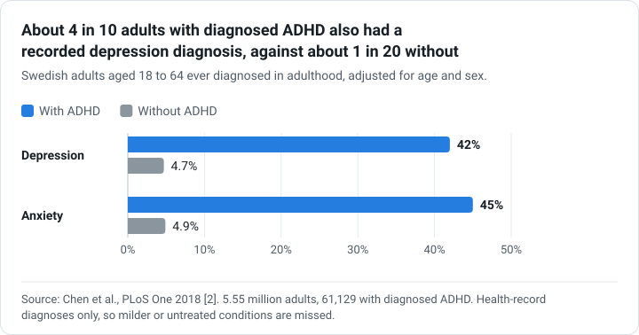

# Anxiety and depression with ADHD: why are they so common?

> **Short answer:** Adults with ADHD have about four to five times the odds of an anxiety disorder or major depression; in Swedish records, about 4 in 10 with diagnosed ADHD had depression recorded. Shared genes explain part of the overlap, and genetic studies suggest ADHD modestly raises later depression risk. Symptoms can look alike, and both can be present at once.

## What the evidence shows

**Adults with ADHD have four to five times the odds.** A 2023 review pooled large studies (each with more than 10,000 people, from surveys, insurance claims and national registers), covering about 551,000 adults with ADHD and 14.5 million without [1]. It found 5.0 times the odds of an anxiety disorder and 4.5 times the odds of major depressive disorder [1]. The pattern held in men and women and, as in the general population, both were more common in women [1].

**Whole-population records show how many people this means.** In Swedish registers covering 5.55 million adults aged 18 to 64, of whom 61,129 had diagnosed ADHD, 42% of adults with ADHD had a depression diagnosis recorded at some point in adulthood, against 4.7% of adults without ADHD (a prevalence ratio of about 9) [2]. For anxiety the figures were 45% against 4.9% [2]. These figures were adjusted for age and sex, and the links held at ages 50 to 64 [2].

<picture>
  <source media="(prefers-color-scheme: dark)" srcset="../assets/charts/05/depression-anxiety-absolute-dark.svg">
  
</picture>

*Recorded depression and anxiety diagnoses in Swedish adults with and without diagnosed ADHD; health records miss milder or untreated conditions. If you are having thoughts of suicide, contacts are on [not medical advice](../08-reading-this-well/not-medical-advice.md).*

These are diagnosed cases in health records, so milder or untreated conditions are missed. People with diagnosed ADHD are often more severely affected and more often assessed for other conditions, which is one reason these ratios are higher than the pooled estimate above. The study was funded by public research grants; several authors reported payments from drug companies [2].

**Childhood ADHD predicts later depression.** In a UK birth cohort (the Avon Longitudinal Study of Parents and Children), ADHD in childhood was linked with recurrent depression at 18 to 25 (odds ratio 1.35, about a third higher odds) [3].

**Genetic evidence points from ADHD towards depression, modestly.** The same paper used Mendelian randomisation, which uses genetic variants as a natural experiment to test whether one condition may lead to another. Genetic liability to ADHD was associated with major depression (odds ratio 1.21, about a fifth higher odds) [3]. The authors read this as consistent with a causal effect, though results differed for more broadly defined depression [3].

**Family-based designs point the same way.** A 2024 Swedish study combined three designs: a comparison of full siblings among about 1 million people, a cohort of 16,477 twins, and Mendelian randomisation [4]. People with ADHD had about four times the rate of later major depression compared with their own siblings without ADHD (hazard ratio 4.12), and genetic liability to ADHD was linked to depression (odds ratio 1.15) [4]. The abstract does not give absolute risks; the authors concluded that ADHD is probably one cause of later depression, though siblings can still differ in ways the design cannot remove [4].

**The arrow may also run the other way.** A 2023 Mendelian randomisation study using larger genetic datasets found a smaller effect of ADHD liability on major depression (odds ratio 1.09), and a larger effect in the reverse direction, from depression liability to ADHD (odds ratio 1.76) [5]. It found no evidence of a causal link between ADHD and anxiety disorders [5]. The reverse estimate has not been checked with sibling or time-ordered designs, and these methods rest on assumptions that cannot be fully tested, so the size and direction of the effects are still uncertain.

**Many genes are shared across conditions.** Most of the common genetic variants linked to ADHD are also linked to other psychiatric conditions. That helps explain why they occur together, without anyone being to blame. The detail is on [genes and inheritance](../02-whats-happening-in-my-brain/genes-and-inheritance.md).

**Overlapping symptoms make the conditions harder to tell apart.** Poor concentration, restlessness, poor sleep and irritability can come from ADHD, anxiety or depression. Strong emotional reactions are also common in ADHD itself, which is covered on [emotions and rejection](../03-why-i-think-and-feel-this-way/emotions-and-rejection.md).

How clinicians tell these conditions apart is covered on [Is it ADHD, or could it be something else?](is-it-adhd-or-something-else.md)

## What is uncertain or debated

- **Which comes first, and why.** Genetic and sibling studies suggest a path from ADHD to depression, and one genetic study suggests a larger path the other way [3–5]. Experiences such as repeated failure, criticism or isolation are hard to measure. The cohort evidence comes from childhood ADHD followed into young adulthood.
- **How much is measurement.** Questionnaires for anxiety and depression include concentration and restlessness items, which people with ADHD may endorse because of ADHD alone. This can inflate overlap estimates.
- **Whether treating ADHD lowers depression risk.** Registry studies link ADHD medication with fewer episodes of depression and suicidal behaviour, but they are observational. See [Real-life outcomes on ADHD medication: what do registries show?](../06-treatment-what-works/what-registries-show.md)
- **Older adults.** There are few data on how the overlap changes after 65 [1].

## What this means for you

Having ADHD and anxiety or depression together is common, not a sign that one diagnosis is wrong. Because the symptoms overlap, it is reasonable for an assessment to look at both, and for treatment of one to be reviewed in light of the other. The overlap is one reason assessment takes time.

These are group averages and cannot tell you which of your difficulties comes from where.

Depression can include thoughts of suicide. If you are having those thoughts, crisis contacts are listed on the [not medical advice](../08-reading-this-well/not-medical-advice.md) page.

Figures on suicide risk in ADHD, with their context, are on [the hard statistics in context](../04-did-i-cause-this-and-where-is-it-going/the-hard-statistics-in-context.md).

## Related pages

- [Is it ADHD, or could it be something else?](is-it-adhd-or-something-else.md)
- [Emotions and rejection in ADHD: why do they hit so hard?](../03-why-i-think-and-feel-this-way/emotions-and-rejection.md)
- [Therapy, coaching and skills training: do they work for ADHD?](../06-treatment-what-works/therapy-and-skills.md)
- [Will ADHD shorten my life? The hard statistics in context](../04-did-i-cause-this-and-where-is-it-going/the-hard-statistics-in-context.md)
- [Addiction and ADHD: is risk higher, and do medicines raise it?](alcohol-drugs-and-addiction.md)
- [Back to all worries](../README.md#find-your-worry)

## Sources

1. Hartman CA, et al. Anxiety, mood, and substance use disorders in adult men and women with and without attention-deficit/hyperactivity disorder: a substantive and methodological overview. *Neurosci Biobehav Rev*. 2023;151:105209. DOI 10.1016/j.neubiorev.2023.105209. PMID 37149075. — **Evidence: Strong**, meta-analysis of studies with more than 10,000 participants each (550,748 with ADHD); confirmed against the PubMed abstract.
2. Chen Q, et al. Common psychiatric and metabolic comorbidity of adult attention-deficit/hyperactivity disorder: a population-based cross-sectional study. *PLoS One*. 2018;13(9):e0204516. DOI 10.1371/journal.pone.0204516. PMID 30256837. — **Evidence: Strong**, national registers, diagnosed cases only, one point in time; percentages from the open-access full text (Table 2).
3. Riglin L, et al. ADHD and depression: investigating a causal explanation. *Psychol Med*. 2021;51(11):1890–7. DOI 10.1017/S0033291720000665. PMID 32249726. — **Evidence: Moderate**, one birth cohort plus Mendelian randomisation.
4. Garcia-Argibay M, et al. Attention-deficit/hyperactivity disorder and major depressive disorder: evidence from multiple genetically informed designs. *Biol Psychiatry*. 2024;95(5):444–52. DOI 10.1016/j.biopsych.2023.07.017. PMID 37562520. — **Evidence: Moderate**, sibling comparison, twin cohort and Mendelian randomisation agree in direction; observational; confirmed against the PubMed abstract.
5. Meisinger C, et al. Understanding the causal relationships of attention-deficit/hyperactivity disorder with mental disorders and suicide attempt: a network Mendelian randomisation study. *BMJ Ment Health*. 2023;26(1):e300642. DOI 10.1136/bmjment-2022-300642. PMID 37669871. — **Evidence: Moderate**, genetic (Mendelian randomisation) study using published genome-wide data; relies on untestable assumptions.

---
Last reviewed: November 2026 · [How these pages are made](../08-reading-this-well/sources-and-guidelines.md) · [Not medical advice](../08-reading-this-well/not-medical-advice.md)
