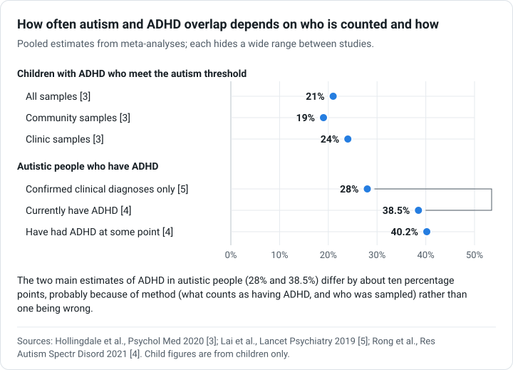

# Autism and ADHD: can you have both?

> **Short answer:** Yes. Current diagnostic manuals allow both diagnoses, and the two often occur together: about one in five children with ADHD meet criteria for autism, and between about one in four and two in five autistic people have ADHD, depending on the study. They run in the same families and share genetic influences. Because some traits overlap, recognising both takes a careful assessment.

## What the evidence shows

**The manuals stopped ruling out a double diagnosis.** The fourth edition of the US diagnostic manual (DSM-IV) treated an autism diagnosis as ruling out ADHD. DSM-5, published in 2013, removed that rule, and its 2022 revision (DSM-5-TR) allows both diagnoses [1]. Studies from before these changes may undercount people with both.

The World Health Organization's ICD-11 also allows autism and ADHD to be diagnosed together [2]. That point comes from a conference abstract comparing ICD-10, DSM-5 and ICD-11, not from the ICD-11 text itself.

**About one in five children with ADHD meet the threshold for autism.** A meta-analysis of 22 studies (61,985 children and adolescents) found that 21% of those with ADHD met the threshold for autism [3]. The figure was similar in community samples (19%) and clinic samples (24%). These figures are from children; equivalent adult data were not found for this page.

**Children with ADHD have many more autistic traits on average.** The same meta-analysis found a large difference in autistic traits between children with and without ADHD (d = 1.23) [3]. By our own calculation from that published figure, not a number from the paper, the two groups' scores overlap by only about half (about 54%).

**Between about one in four and two in five autistic people have ADHD.** A 2021 meta-analysis of 63 articles estimated that 38.5% of autistic people currently have ADHD, and 40.2% have had it at some point [4]. Estimates varied widely, and depended on age, intellectual disability, how people were recruited and which diagnostic criteria were used [4].

A 2019 meta-analysis that counted only confirmed clinical diagnoses found a lower pooled figure: 28% of autistic people had ADHD [5]. The difference is probably about method (what counts as having ADHD, and who was sampled) rather than one estimate being wrong. Both found ADHD to be the most common, or among the most common, co-occurring diagnoses in autism [4][5].

<picture>
  <source media="(prefers-color-scheme: dark)" srcset="../assets/charts/05/autism-adhd-overlap-dark.svg">
  
</picture>

*Pooled estimates of how often autism and ADHD occur together from three meta-analyses; each figure hides wide variation between studies, and the child figures come from children only.*

**They run together in families.** In Swedish national registers covering about 1.9 million people born from 1987 to 2006, autistic people had about 22 times the odds of also having an ADHD diagnosis [6]. Their relatives also had raised odds of ADHD, and more so the more genes they shared: about 18 times for identical twins, against about 4.3 for non-identical twins and 4.6 for full siblings [6].

The authors read the pattern as pointing to shared genetic influences [6]. These are relative figures; the abstract does not give the share of relatives affected.

Genome-wide studies also find that most ADHD-linked variants are shared with other conditions, including autism; see [genes and inheritance](../02-whats-happening-in-my-brain/genes-and-inheritance.md).

**Some traits look alike for different reasons.** Difficulty paying attention in conversation, being overwhelmed by noise, social difficulties and intense focus on a topic can appear in both. A common clinical description, not checked against a source for this page, is that in autism inattention may come from sensory overload or from a topic not engaging the person, while in ADHD it may come from difficulty holding attention at all.

A careful assessment looks at whether ADHD-like traits are better explained by autism, or the reverse, and whether both are present. A review of the overlap concluded that the two share features but are distinct enough to warrant separate diagnoses [1].

## What is uncertain or debated

- **Prevalence figures vary a lot** with how samples were found, which assessment was used, and age. The two main meta-analyses of ADHD in autism differ by about ten percentage points (28% and 38.5%) [4][5], and each pooled estimate hides wide ranges.
- **Adults, especially women, are under-studied.** Most data are from children. Adults diagnosed late with either condition may be missed for the other.
- **Overlap or one combined condition?** Some researchers see autism and ADHD as distinct conditions that often co-occur; others see them as overlapping parts of a broader neurodevelopmental spectrum. Current evidence does not settle this.
- **Treatment in people with both** has fewer trials than treatment of ADHD alone. Medication response may differ, and these decisions are for a prescriber.
- **Hyperfocus and intense interests** are described in both, but research on them is thin; see [attention regulation and hyperfocus](../03-why-i-think-and-feel-this-way/attention-regulation-and-hyperfocus.md).

## What this means for you

If you have one diagnosis and recognise traits of the other, that is common and is a reasonable thing to raise at an assessment. Overlapping traits are also why an online checklist cannot tell the two apart. Some people find that understanding both helps explain experiences that neither diagnosis covered alone.

## Related pages

- [Is it ADHD, or could it be something else?](is-it-adhd-or-something-else.md)
- [Genes and inheritance](../02-whats-happening-in-my-brain/genes-and-inheritance.md)
- [How diagnosis works](../01-is-this-real/how-diagnosis-works.md)
- [Why no two ADHD brains are alike](../02-whats-happening-in-my-brain/why-no-two-adhd-brains-are-alike.md)
- [Back to all worries](../README.md#find-your-worry)

## Sources

1. Antshel KM, et al. Autism spectrum disorders and ADHD: overlapping phenomenology, diagnostic issues, and treatment considerations. *Curr Psychiatry Rep*. 2019;21(5):34. DOI 10.1007/s11920-019-1020-5. PMID 30903299. — **Evidence: Moderate**, narrative review.
2. Zigic N, et al. Neurodevelopmental disorders in ICD-11 classification. *Eur Psychiatry*. 2023 (conference abstract). PMC10411432. — **Evidence: Limited**, conference abstract describing the classification; cited only for the ICD-11 co-diagnosis point, which its abstract states.
3. Hollingdale J, et al. Autistic spectrum disorder symptoms in children and adolescents with attention-deficit/hyperactivity disorder: a meta-analytical review. *Psychol Med*. 2020;50(13):2240–53. DOI 10.1017/S0033291719002368. PMID 31530292. — **Evidence: Moderate**, meta-analysis of 22 publications, children and adolescents only.
4. Rong Y, et al. Prevalence of attention-deficit/hyperactivity disorder in individuals with autism spectrum disorder: a meta-analysis. *Res Autism Spectr Disord*. 2021;83:101759. DOI 10.1016/j.rasd.2021.101759. — **Evidence: Moderate**, meta-analysis of 63 articles with high heterogeneity; record confirmed in Crossref (not indexed in PubMed), figures from index-record abstracts.
5. Lai MC, et al. Prevalence of co-occurring mental health diagnoses in the autism population: a systematic review and meta-analysis. *Lancet Psychiatry*. 2019;6(10):819–29. DOI 10.1016/S2215-0366(19)30289-5. PMID 31447415. — **Evidence: Strong**, meta-analysis of 96 studies using confirmed clinical diagnoses.
6. Ghirardi L, et al. The familial co-aggregation of ASD and ADHD: a register-based cohort study. *Mol Psychiatry*. 2018;23(2):257–62. DOI 10.1038/mp.2017.17. PMID 28242872. — **Evidence: Strong**, national family registry.

---
Last reviewed: November 2026 · [How these pages are made](../08-reading-this-well/sources-and-guidelines.md) · [Not medical advice](../08-reading-this-well/not-medical-advice.md)
