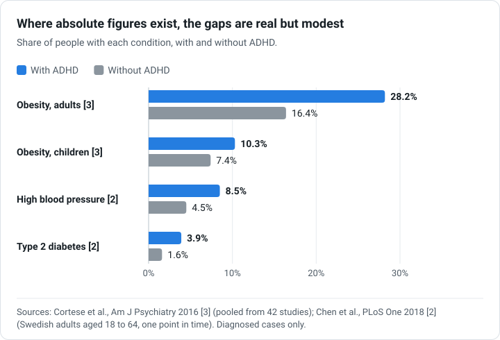

# Physical health problems and ADHD: is there a link?

> **Short answer:** Yes, on average: in a Swedish study, adults with ADHD had higher rates of 34 of 35 physical conditions, and shared genes seemed to explain much of the overlap. Where absolute figures exist, the gaps are real; for example, about 28% of adults with ADHD had obesity against 16% without. Whether changing habits lowers the risk has barely been tested.

## What the evidence shows

**Rates are raised across almost every body system.** A Swedish registry study of 4.8 million adults, forming 4.3 million pairs of siblings, looked at 35 physical conditions [1]. Adults with ADHD had higher rates of 34 of them, across the nervous system, lungs, joints and muscles, metabolism, heart and circulation, gut, urinary system and skin; the exception was rheumatoid arthritis [1]. The paper reports odds ratios and whole-cohort rates, not rates for people with and without ADHD separately.

**The strongest links were with sleep, lungs, the liver and weight.** The largest odds ratios were for alcohol-related liver disease (4.7 times the odds), sleep disorders (4.6), chronic obstructive pulmonary disease (3.2), epilepsy (3.0), fatty liver disease (2.9) and obesity (2.7) [1]. Delayed body clocks and other sleep differences in ADHD are covered on [sleep and the body clock](../03-why-i-think-and-feel-this-way/sleep-and-the-body-clock.md).

**Shared genes explain much of the overlap, but not all of it.** Using the sibling data, the study estimated that shared genetic factors explained 60% to 69% of the overlap for respiratory, musculoskeletal and metabolic conditions [1]. Links with nervous system conditions were mainly explained by non-shared environmental factors, and links with age-related conditions (heart disease, Parkinson's disease, dementia; 1.3 to 2.4 times the odds) did not show the same genetic pattern [1]. Shared genes do not mean the conditions are fixed; they mean the same underlying factors raise the chances of both.

**Diabetes and high blood pressure are about twice as common.** In Swedish adults aged 18 to 64, a type 2 diabetes diagnosis was recorded in 3.9% of those with diagnosed ADHD against 1.6% without, and high blood pressure in 8.5% against 4.5% [2]. The link held at ages 50 to 64 [2]. This was a single snapshot in time, so it cannot show which came first.

Whether ADHD medicines affect blood pressure and heart risk is a separate question, covered on [Is ADHD medication safe? Heart, growth, psychosis and misuse](../06-treatment-what-works/medication-safety.md).

**Obesity is moderately more common, more so in adults.** A meta-analysis of 42 studies (48,161 people with ADHD) found adults with ADHD had about 1.55 times the odds of obesity [3]. In absolute terms, the pooled share with obesity was 28.2% of adults with ADHD against 16.4% without; in children it was 10.3% against 7.4% (odds ratio 1.20) [3]. The association remained in studies that adjusted for other factors, used direct diagnostic interviews, or measured height and weight directly [3].

<picture>
  <source media="(prefers-color-scheme: dark)" srcset="../assets/charts/05/physical-health-absolute-dark.svg">
  
</picture>

*Absolute figures for obesity, high blood pressure and diabetes, from two different studies (figures for heart and circulation disease are in the text); these are observational and cannot show which came first.*

**An earlier review rated some links as well documented and others as tentative.** A systematic review of 126 mostly small studies rated obesity, sleep disorders and asthma as well documented in adult ADHD, and migraine and coeliac disease as tentative [4]. It noted that one large registry study had found no link with cardiovascular disease [4].

**Heart and circulation disease: the largest study finds a raised risk.** In 5.4 million Swedish adults born between 1941 and 1983 and followed for about 12 years, 38.05% of those with ADHD had at least one cardiovascular diagnosis, against 23.57% of those without [5]. That is about twice the rate (hazard ratio 2.05), falling to 1.65 after accounting for education, diabetes, obesity, smoking, sleep problems and other psychiatric conditions, and the link was similar in people who did and did not take psychiatric medicines [5]. Together with the modestly raised odds in the sibling study [1], this points to a real link, although observational studies cannot show that ADHD itself is the cause.

**Injuries are more common, especially in young people.** Across 28 studies, children and teenagers with ADHD had about 1.5 times the odds of unintentional injuries (odds ratio 1.53) [6]. Studies that compared the same children on and off ADHD medication found about 12% lower injury risk during medicated periods, at least in the short term [6]. Road crash figures and their context are on [the hard statistics in context](../04-did-i-cause-this-and-where-is-it-going/the-hard-statistics-in-context.md).

## What is uncertain or debated

- **Cause and direction.** These are observational studies. Poor sleep, smoking, alcohol, diet, inactivity, stress, poverty and side effects of other treatments could each sit between ADHD and illness. Some physical conditions may also make attention worse. Mendelian randomisation studies, which use genetic variants as a natural experiment, suggest effects in both directions between ADHD and higher body weight, stronger for childhood obesity, with some evidence of effects on coronary heart disease and stroke, though they rest on assumptions that cannot be fully tested [7].
- **Diagnosed cases only.** Registry studies count people who reached health services, who may be more severely affected or more often checked for other conditions.
- **Absolute risks are mostly missing.** The largest registry study reports relative figures. Absolute figures were found only for obesity, type 2 diabetes, high blood pressure and cardiovascular disease as a whole [2, 3, 5]; for most other conditions, how many extra people per thousand are affected was not available in the sources checked.
- **Which links can be changed.** Few studies test whether treating ADHD, or helping with sleep, activity or smoking, changes physical health outcomes in people with ADHD.

## What this means for you

At group level, ADHD comes with higher rates of many physical conditions, and some of that overlap may run through habits and sleep that can change, though few studies have tested this. Much of it also seems to reflect shared biology, which is no one's fault. These averages cannot predict an individual's health, but they are a reason for physical health to be part of ADHD care rather than an afterthought.

## Related pages

- [Sleep and ADHD: why can't I fall asleep, and is sleep the cause?](../03-why-i-think-and-feel-this-way/sleep-and-the-body-clock.md)
- [Is ADHD medication safe? Heart, growth, psychosis and misuse](../06-treatment-what-works/medication-safety.md)
- [Addiction and ADHD: is risk higher, and do medicines raise it?](alcohol-drugs-and-addiction.md)
- [Will ADHD shorten my life? The hard statistics in context](../04-did-i-cause-this-and-where-is-it-going/the-hard-statistics-in-context.md)
- [Back to all worries](../README.md#find-your-worry)

## Sources

1. Du Rietz E, et al. Mapping phenotypic and aetiological associations between ADHD and physical conditions in adulthood in Sweden: a genetically informed register study. *Lancet Psychiatry*. 2021;8(9):774–83. DOI 10.1016/S2215-0366(21)00171-1. PMID 34242595. — **Evidence: Strong**, national registry with sibling-based genetic modelling; figures checked against the abstract and open-access full text.
2. Chen Q, et al. Common psychiatric and metabolic comorbidity of adult attention-deficit/hyperactivity disorder: a population-based cross-sectional study. *PLoS One*. 2018;13(9):e0204516. DOI 10.1371/journal.pone.0204516. PMID 30256837. — **Evidence: Strong**, national registers, cross-sectional; percentages from the full text (Table 2); publicly funded.
3. Cortese S, et al. Association between ADHD and obesity: a systematic review and meta-analysis. *Am J Psychiatry*. 2016;173(1):34–43. DOI 10.1176/appi.ajp.2015.15020266. PMID 26315982. — **Evidence: Moderate**, meta-analysis of 42 observational studies.
4. Instanes JT, et al. Adult ADHD and comorbid somatic disease: a systematic literature review. *J Atten Disord*. 2018;22(3):203–28. DOI 10.1177/1087054716669589. PMID 27664125. — **Evidence: Moderate**, systematic review of 126 mostly small studies, no pooling.
5. Li L, et al. Attention-deficit/hyperactivity disorder as a risk factor for cardiovascular diseases: a nationwide population-based cohort study. *World Psychiatry*. 2022;21(3):452–9. DOI 10.1002/wps.21020. PMID 36073682. — **Evidence: Strong**, national registry cohort of 5.4 million adults followed for about 12 years, with absolute figures; observational; confirmed against the PubMed abstract.
6. Ruiz-Goikoetxea M, et al. Risk of unintentional injuries in children and adolescents with ADHD and the impact of ADHD medications: a systematic review and meta-analysis. *Neurosci Biobehav Rev*. 2018;84:63–71. DOI 10.1016/j.neubiorev.2017.11.007. PMID 29162520. — **Evidence: Moderate**, meta-analysis of 28 studies, children and adolescents; medication estimate from 5 self-controlled or similar studies.
7. Riglin L, Stergiakouli E. Mendelian randomisation studies of attention deficit hyperactivity disorder. *JCPP Adv*. 2022;2(4):e12117. DOI 10.1002/jcv2.12117. PMID 37431426. — **Evidence: Moderate**, narrative review of about 50 Mendelian randomisation studies; confirmed against the PubMed abstract.

---
Last reviewed: November 2026 · [How these pages are made](../08-reading-this-well/sources-and-guidelines.md) · [Not medical advice](../08-reading-this-well/not-medical-advice.md)
