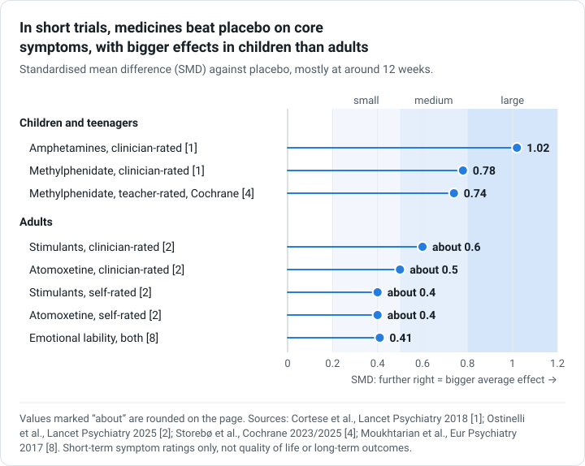

# How well does ADHD medication work?

> **Short answer:** In short-term trials, stimulant medication clearly reduces core ADHD symptoms more than placebo: a medium-to-large effect in children and a medium effect in adults. Reviews agree on the size but disagree on its certainty, and no treatment has high-certainty long-term evidence. Evidence on quality of life is mixed, with any gains smaller than for symptoms.

## What the evidence shows

How to read the effect sizes on this page (1 min)

Most results are given as a standardised mean difference (SMD), which expresses the gap between the medicine and placebo groups in units of how spread out people's scores are. This page writes every SMD as a positive number meaning improvement on the medicine; some papers print the same result with a minus sign because lower scores mean fewer symptoms. An SMD of 0.8 means that the average person on medication ends up with fewer symptoms than about 79% of people on placebo, but the two groups still overlap by roughly 69%. An SMD of 0.6 means the groups overlap by about 76%.

These percentages are this page's own calculations from the standard formulas for effect sizes (assuming normally distributed scores), not figures from any study. Effect sizes are explained in more detail on [how to read the evidence](../08-reading-this-well/how-to-read-the-evidence.md).

**Children and teenagers: medium-to-large effects in the short term.** A network meta-analysis of 133 double-blind trials, with about 10,000 children and adolescents in the main analysis, found every drug studied beat placebo on clinician-rated symptoms at around 12 weeks [1]. Amphetamines had an SMD of about 1.02 and methylphenidate about 0.78 [1]. The authors favoured methylphenidate as the first choice in children, weighing benefit against side effects.

**Adults: real but smaller effects.** In the same analysis, about 8,000 adults were included, and amphetamines were favoured over methylphenidate, atomoxetine and modafinil [1]. Which of these medicines is approved for ADHD differs by country; see [How do ADHD medicines work?](how-adhd-medicines-work.md)

A 2025 analysis of 113 trials in 14,887 adults found that only stimulants and atomoxetine reduced core symptoms on *both* clinician and self-ratings, at around 12 weeks [2]. Clinician-rated SMDs were roughly 0.6 for stimulants and 0.5 for atomoxetine, and self-rated SMDs about 0.4 for both [2].

<picture>
  <source media="(prefers-color-scheme: dark)" srcset="../assets/charts/06/medication-effect-sizes-dark.svg">
  
</picture>

*Short-term effect sizes for core symptoms from four reviews, with bands following the convention on [how to read the evidence](../08-reading-this-well/how-to-read-the-evidence.md) (0.2 small, 0.5 medium, 0.8 large); they say nothing about quality of life or long-term benefit, and averages hide individual response.*

**Quality of life: the evidence is mixed.** The same 2025 adult analysis found that medicines were not efficacious on other relevant outcomes such as quality of life, and that longer-term effects had been little studied [2]. A 2025 meta-analysis of 17 placebo-controlled trials (5,388 people aged 6 and over) did find quality-of-life gains, with SMDs of 0.51 for amphetamines, 0.38 for methylphenidate and 0.30 for atomoxetine, smaller than the effects on symptoms [3]. For atomoxetine the gain did not differ between children and adults; the abstract does not give adult-only figures for stimulants [3].

The two analyses used different sets of trials and different statistical models, and quality of life is often self-rated by people who may guess whether they are on the real drug. Smaller gains in quality of life than in symptoms may mean that the scales miss what changes, that trials are too short, or that symptom relief alone does not fix the practical and social consequences of ADHD.

**Cochrane and a BMJ review rate the same evidence differently.** The Cochrane review of methylphenidate in children found a teacher-rated SMD of 0.74 (21 trials, 1,728 participants) in both its 2023 version and its December 2025 update [4]. This was translated to about 10.6 points on the ADHD Rating Scale (which the review describes as running from 0 to 72 points), and the 2025 update treats 6.6 points as the smallest clinically relevant difference [4]. Cochrane rated the certainty of its outcomes as *very low* [4].

A 2025 BMJ umbrella review re-analysed the most robust meta-analysis for each of 221 combinations of treatment, comparison and outcome [5]. It found a similar effect for methylphenidate in children (SMD above 0.75, consistent across raters) and rated it *moderate or high* certainty [5].

**The gradings differ because judgement enters at set steps.** Certainty is judged with a system called GRADE, which asks reviewers to mark evidence down for risk of bias, inconsistency between studies and other problems. Cochrane's authors treated almost all trials as high risk of bias, partly because side effects such as appetite loss can let children, parents and teachers guess who is on the real drug, and partly because many trials were industry-funded [4, 6].

Critics, including the European ADHD Guidelines Group, argued that these choices were too severe, that "unclear" and "high" risk had been merged, and that high- and low-risk trials gave similar results anyway [6]. The last two points are summarised here partly from a secondary commentary on that critique and were not checked against its full text. The Cochrane authors published a reply to a parallel critique by members of the same group [7], whose full text was not checked for this page.

Both sides are using the same rules; they apply judgement differently at the steps where judgement is required.

**Emotional symptoms improve, but less than core symptoms.** In adults, stimulants and atomoxetine reduced emotional lability (quick, intense mood shifts) with an SMD of about 0.41 (printed as −0.41 in the paper, where lower scores mean fewer symptoms), about half the effect on core symptoms in the same trials (0.8) [8].

## What is uncertain or debated

**Long-term benefit is the biggest gap.** The BMJ umbrella review found no high-certainty, long-term evidence for *any* ADHD treatment, drug or non-drug [5]. Trials rarely last more than a few months. Longer-term evidence comes from follow-ups and registries; see [Stopping ADHD medication: do benefits fade, and is it for life?](staying-on-or-stopping-medication.md)

**Averages hide individual response.** An SMD describes the average difference between groups. Some people improve a great deal, some a little, and some stop because of side effects; trials cannot tell an individual reader where they will fall.

**Most of the data come from children.** Adult trials are fewer, shorter and show smaller effects. Where this page gives a child figure, it should not be read as an adult one.

**Rating scales measure symptoms, not lives.** Trials mostly count symptoms. School results, work, relationships and wellbeing are measured less often and less consistently.

## What this means for you

If someone tells you "medication doesn't really work" or "Cochrane says it's useless", the more accurate picture is that short-term symptom benefit is consistent across reviews. The confidence placed in it, and evidence beyond a year, are genuinely debated, and whether the symptom benefit improves adults' quality of life is still disputed. Whether the expected benefit is worth it for you is a question to work through with a prescriber, who can weigh your own goals and health.

## Related pages

- [How do ADHD medicines work?](how-adhd-medicines-work.md)
- [Is ADHD medication safe? Heart, growth, psychosis and misuse](medication-safety.md)
- [Real-life outcomes on ADHD medication: what do registries show?](what-registries-show.md)
- [Therapy, coaching and skills training: do they work for ADHD?](therapy-and-skills.md)
- [Stopping ADHD medication: do benefits fade, and is it for life?](staying-on-or-stopping-medication.md)
- [Back to all worries](../README.md#find-your-worry)

## Sources

1. Cortese S, et al. Comparative efficacy and tolerability of medications for attention-deficit hyperactivity disorder in children, adolescents, and adults: a systematic review and network meta-analysis. *Lancet Psychiatry*. 2018;5(9):727–38. DOI 10.1016/S2215-0366(18)30269-4. PMID 30097390. — **Evidence: Strong** for the short term, network meta-analysis of 133 double-blind trials.
2. Ostinelli EG, et al. Comparative efficacy and acceptability of pharmacological, psychological, and neurostimulatory interventions for ADHD in adults: a systematic review and component network meta-analysis. *Lancet Psychiatry*. 2025;12(1):32–43. DOI 10.1016/S2215-0366(24)00360-2. — **Evidence: Strong**, 113 trials, 14,887 adults; certainty very low to moderate.
3. Bellato A, et al. Systematic review and meta-analysis: effects of pharmacological treatment for attention-deficit/hyperactivity disorder on quality of life. *J Am Acad Child Adolesc Psychiatry*. 2025;64(3):346–61. DOI 10.1016/j.jaac.2024.05.023. PMID 38823477. — **Evidence: Moderate**, meta-analysis of 17 placebo-controlled trials, children and adults combined, quality of life often self-rated; confirmed against the PubMed abstract.
4. Storebø OJ, et al. Methylphenidate for children and adolescents with attention deficit hyperactivity disorder (ADHD). *Cochrane Database Syst Rev*. 2023 (CD009885.pub3, PMID 36971690) and 2025 Issue 12 (CD009885.pub4, DOI 10.1002/14651858.CD009885.pub4, PMID 41342306). — **Evidence: Contested**, the effect size is consistent across reviews while its certainty rating is disputed; rated very low certainty by its authors.
5. Gosling CJ, et al. Benefits and harms of ADHD interventions: umbrella review and platform for shared decision making. *BMJ*. 2025;391:e085875. DOI 10.1136/bmj-2025-085875. PMID 41297970. — **Evidence: Strong**, umbrella review covering 221 treatment-comparison-outcome combinations.
6. Banaschewski T, et al. Methylphenidate for ADHD in children and adolescents: throwing the baby out with the bathwater. *Evid Based Ment Health*. 2016. PMID 27935807. — **Evidence: Limited, expert commentary**, a critique of the 2015 Cochrane review by the European ADHD Guidelines Group; some points summarised from a secondary commentary.
7. Storebø OJ, et al. Response to "Trust, but verify" by Banaschewski et al. *Z Kinder Jugendpsychiatr Psychother*. 2016;44(5):334–5. DOI 10.1024/1422-4917/a000472. PMID 27658627. — **Commentary**, the Cochrane authors' reply to critics; PubMed record has no abstract and the full text was not checked.
8. Moukhtarian TR, et al. Effects of stimulants and atomoxetine on emotional lability in adults: a systematic review and meta-analysis. *Eur Psychiatry*. 2017;44:198–207. DOI 10.1016/j.eurpsy.2017.05.021. PMID 28646732. — **Evidence: Moderate**, 9 trials.

---
Last reviewed: November 2026 · [How these pages are made](../08-reading-this-well/sources-and-guidelines.md) · [Not medical advice](../08-reading-this-well/not-medical-advice.md)
