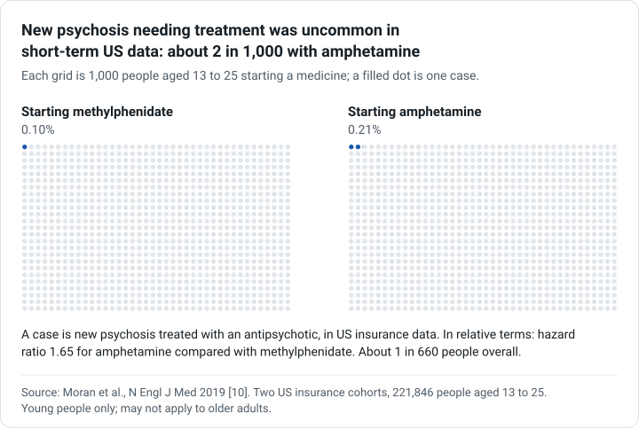

# Is ADHD medication safe? Heart, growth, psychosis and misuse

> **Short answer:** Serious harms are uncommon. Long-term use goes with higher odds of high blood pressure and arterial disease, of unknown absolute size. One follow-up linked consistent childhood use with about 2.5 cm less adult height; another found no difference. About 2 in 1,000 young people starting amphetamine developed psychosis; odds were higher at high doses, with no absolute figure found.

This page discusses heart disease, psychosis and other serious-harm statistics. The short answer above is the main point.

## What the evidence shows

**Common side effects are frequent and mostly non-serious.** The Cochrane review of methylphenidate in children found higher rates of sleep problems and reduced appetite than placebo [1]. Its later versions (2023, and the December 2025 update) report that methylphenidate may increase non-serious adverse events such as sleep problems and decreased appetite [2]. In the 2025 update, non-serious adverse events were about 23% more common with methylphenidate than with placebo (risk ratio 1.23, 35 trials) [2].

**No clear difference was found in serious adverse events.** The later Cochrane versions found no clear difference in serious adverse events between methylphenidate and placebo (risk ratio 0.80, with a wide range from 0.39 to 1.67, from 26 trials and 3,673 participants; this figure is from the 2025 update) [2]. The review authors rate this evidence very low certainty; why is explained on [How well does ADHD medication work?](how-well-medication-works.md)

**Blood pressure and pulse rise slightly on average.** A 2025 network meta-analysis of 102 trials and more than 22,700 people found small average increases in blood pressure and pulse with most ADHD medicines, stimulant and non-stimulant alike; guanfacine was the exception and lowered both [3]. The trials were short: only four informed medium-term effects and none the long term. The authors therefore recommend monitoring blood pressure and heart rate whatever the medicine [3].

**Long-term use is linked to a modestly higher risk of some heart and blood-vessel disease.** A Swedish study of 278,027 people with ADHD aged 6 to 64, followed for up to 14 years, compared 10,388 people who developed cardiovascular disease with 51,672 matched people who did not [4]. Each additional year of medication was associated with about 4% higher odds of cardiovascular disease (adjusted odds ratio 1.04), with a steeper rise of about 8% per year during the first three years of use (adjusted odds ratio 1.08) [4].

The link was clearest for high blood pressure (about 1.7 times the odds after 3 to 5 years of use, and 1.8 times after more than 5 years) and arterial disease (about 1.65 times the odds after 3 to 5 years; the estimate for more than 5 years was not statistically clear) [4]. There was no significant link with heart failure, irregular heart rhythms, ischaemic heart disease (narrowed heart arteries), stroke or blood clots [4].

**The absolute extra heart risk is not known.** The overall rate of cardiovascular disease in the cohort was about 7.3 cases per 1,000 people per year [4]. No absolute extra risk per year of medication, or per 1,000 people treated, was found in the published abstract or in the summaries searched for this page. This page does not estimate one: the study's design gives odds ratios, which cannot safely be turned into extra cases without rates for medicated and unmedicated people separately.

Because the study is observational, people who stay on medication may differ in ways that also affect heart health.

**Children's growth slows a little during treatment.** A meta-analysis of 18 studies (4,868 children) found long-term methylphenidate was associated with small reductions in height and weight relative to expected growth (SMD 0.27 for height), mostly in the first two years [5]. In the long-term follow-up of the MTA study, young adults who had taken medication consistently through childhood were on average about 2.4 to 2.6 cm shorter than comparison groups who had used less medication [6]. The authors described these subgroup comparisons as hypothesis-generating rather than settled [6].

**Whether final adult height is affected in general is unresolved.** A US birth-cohort study of 340 children with ADHD and 680 without found that neither ADHD nor stimulant treatment was associated with a difference in final adult height, though treated boys had their growth spurt slightly later [7]. Growth in children is covered further in [children and medication](../07-family-work-and-other-people/children-and-medication.md).

**Psychosis is rare, and the signal is concentrated in amphetamines.** Among 13- to 25-year-olds in US insurance data starting a stimulant, new psychosis treated with an antipsychotic occurred in about 1 in 660 people overall: 0.10% of those starting methylphenidate and 0.21% of those starting amphetamine (hazard ratio 1.65 for amphetamine) [8].

<picture>
  <source media="(prefers-color-scheme: dark)" srcset="../assets/charts/06/psychosis-per-1000-dark.svg">
  
</picture>

*New psychosis in young people starting methylphenidate or amphetamine, shown out of 1,000; the data cover 13- to 25-year-olds in the US only, and no absolute figure for high doses was found.*

A later case-control study of 16- to 35-year-olds admitted to one US psychiatric hospital found past-month prescription amphetamine use was associated with 2.7 times the odds of a first episode of psychosis or mania, rising to about 5.3 times at doses above 30 mg dextroamphetamine-equivalent; methylphenidate was not associated [9]. That study compared hospitalised patients with other patients, which can exaggerate associations. The dose threshold is that study's finding rather than a safety limit, and no absolute risk for high doses was found.

If you or someone close to you has new, frightening changes in thinking or mood, there are urgent contacts on [if you need help now](../08-reading-this-well/not-medical-advice.md#if-you-need-help-now).

**Misuse and diversion are real, separate problems.** Using someone else's stimulant, or one's own in ways not prescribed, is common in some groups. A systematic review of 111 studies found reported rates of non-medical use from 2% to 59% and of diversion (giving or selling) from under 1% to 80%, with most studies in college students and definitions varying widely [10]. A 2015 meta-analysis estimated about 17% of college students had misused stimulants, mainly for study [11].

Whether prescribed treatment raises addiction risk for the person taking it is a different question, covered on [Addiction and ADHD: is risk higher, and do medicines raise it?](../05-what-often-comes-with-it/alcohol-drugs-and-addiction.md)

## What is uncertain or debated

- **Long-term safety evidence is mostly observational.** Trials last weeks or months; nearly all long-term safety evidence comes from registries and cohorts.
- **Unmeasured factors.** The cardiovascular link may be partly explained by things registries cannot measure, such as smoking, weight or stress.
- **Who the psychosis data cover.** The psychosis data come from young people in the US and may not apply to older adults.
- **Older adults.** There are few safety data for adults starting medication after 60.

## What this means for you

These are the risks that guidelines build monitoring around: blood pressure and pulse, growth in children, sleep and appetite, and mental-health changes. Each is a reason for monitoring rather than a verdict on whether medication is right for any one person. A small average risk can still matter for someone with existing heart disease or a personal or family history of psychosis, which is why these are discussed with a prescriber before and during treatment.

Decisions about starting, changing or stopping medication belong in that conversation.

## Related pages

- [How well does ADHD medication work?](how-well-medication-works.md)
- [Real-life outcomes on ADHD medication: what do registries show?](what-registries-show.md)
- [Physical health problems and ADHD: is there a link?](../05-what-often-comes-with-it/physical-health.md)
- [Back to all worries](../README.md#find-your-worry)

## Sources

1. Storebø OJ, et al. Methylphenidate for children and adolescents with attention deficit hyperactivity disorder (ADHD). *Cochrane Database Syst Rev*. 2015. CD009885.pub2. PMID 26599576. — **Evidence: Contested**, the effect size is consistent across reviews while its certainty rating is disputed.
2. Storebø OJ, et al. Methylphenidate for children and adolescents with attention deficit hyperactivity disorder (ADHD). *Cochrane Database Syst Rev*. 2023 (CD009885.pub3, PMID 36971690) and 2025, Issue 12 (CD009885.pub4, DOI 10.1002/14651858.CD009885.pub4, PMID 41342306). — **Evidence: Contested**, the effect size is consistent across reviews while its certainty rating is disputed; 26 trials for serious adverse events, rated very low certainty by authors. Serious and non-serious adverse event figures confirmed from the 2025 (pub4) abstract.
3. Farhat LC, et al. Comparative cardiovascular safety of medications for attention-deficit hyperactivity disorder in children, adolescents, and adults: a systematic review and network meta-analysis. *Lancet Psychiatry*. 2025;12(5):355–65. DOI 10.1016/S2215-0366(25)00062-8. PMID 40203844. — **Evidence: Moderate**, 102 short-term trials (median about 7 weeks); very low certainty for several adult estimates.
4. Zhang L, et al. Attention-deficit/hyperactivity disorder medications and long-term risk of cardiovascular diseases. *JAMA Psychiatry*. 2024;81(2):178–87 (online November 2023). DOI 10.1001/jamapsychiatry.2023.4294. PMID 37991787. PMC10851097. — **Evidence: Moderate**, Swedish nested case-control, observational.
5. Carucci S, et al. Long term methylphenidate exposure and growth in children and adolescents with ADHD: a systematic review and meta-analysis. *Neurosci Biobehav Rev*. 2021;120:509–25. DOI 10.1016/j.neubiorev.2020.09.031. PMID 33080250. — **Evidence: Moderate**, 18 observational studies.
6. Swanson JM, et al. Young adult outcomes in the follow-up of the multimodal treatment study of attention-deficit/hyperactivity disorder. *J Child Psychol Psychiatry*. 2017;58(6):663–78. DOI 10.1111/jcpp.12684. PMID 28295312. — **Evidence: Moderate**, observational follow-up of one trial cohort.
7. Harstad EB, et al. ADHD, stimulant treatment, and growth: a longitudinal study. *Pediatrics*. 2014;134(4):e935–44. DOI 10.1542/peds.2014-0428. PMID 25180281. — **Evidence: Moderate**, population birth cohort (Rochester, Minnesota), adult height available for a subset.
8. Moran LV, et al. Psychosis with methylphenidate or amphetamine in patients with ADHD. *N Engl J Med*. 2019;380:1128–38. DOI 10.1056/NEJMoa1813751. PMID 30893533. — **Evidence: Moderate**, two US insurance cohorts, 221,846 13–25-year-olds.
9. Moran LV, et al. Risk of incident psychosis and mania with prescription amphetamines. *Am J Psychiatry*. 2024;181(10):901–9. DOI 10.1176/appi.ajp.20230329. PMID 39262211. — **Evidence: Limited to moderate**, single-hospital case-control (1,374 cases, 2,748 controls), selection bias possible.
10. Faraone SV, et al. Systematic review: nonmedical use of prescription stimulants: risk factors, outcomes, and risk reduction strategies. *J Am Acad Child Adolesc Psychiatry*. 2020;59(1):100–12. DOI 10.1016/j.jaac.2019.06.012. PMID 31326580. — **Evidence: Moderate**, 111 heterogeneous studies; rates confirmed against the PubMed abstract (2.1% to 58.7% and 0.7% to 80.0%).
11. Benson K, et al. Misuse of stimulant medication among college students: a comprehensive review and meta-analysis. *Clin Child Fam Psychol Rev*. 2015;18:50–76. DOI 10.1007/s10567-014-0177-z. PMID 25575768. — **Evidence: Moderate**, 30 articles, college samples only.

---
Last reviewed: November 2026 · [How these pages are made](../08-reading-this-well/sources-and-guidelines.md) · [Not medical advice](../08-reading-this-well/not-medical-advice.md)
