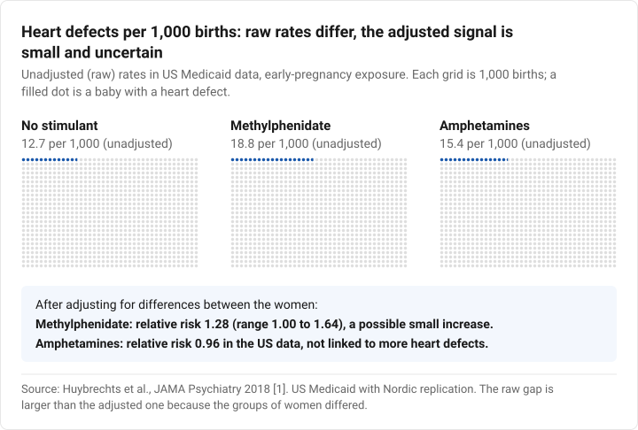

# Pregnancy, breastfeeding and ADHD medication: is it safe?

> **Short answer:** Large registry studies are broadly reassuring about stimulants in pregnancy: after accounting for the mother's own ADHD and circumstances, there was no overall rise in birth defects, miscarriage or later neurodevelopmental conditions. Small signals remain for heart defects (methylphenidate), pre-eclampsia and preterm birth with continued use. Breastfeeding data are limited but suggest little methylphenidate reaches the baby.

This page discusses birth defects and pregnancy complications. The short answer above is the main point.

## What the evidence shows

**Birth defects: no overall rise, one uncertain signal.** A study pooling US Medicaid data with registers from five Nordic countries looked at stimulant use in the first three months of pregnancy [1]. In the US Medicaid data, amphetamines were not linked to more malformations (relative risk 1.05 for any, 0.96 for heart defects). Methylphenidate had adjusted relative risks of 1.11 for any malformation and 1.28 for heart defects, neither statistically clear on the US data alone [1].

The Nordic data gave the same heart-defect estimate (1.28, again not statistically clear on its own). When the two were combined, the pooled relative risk was 1.28 with a range of 1.00 to 1.64, at the edge of statistical significance [1]. The authors described this as a possible small increase in heart defects with methylphenidate but not amphetamines.

**Two sets of absolute heart-defect figures circulate, both correct.** In the US Medicaid data, the raw (unadjusted) rate of heart defects was 12.7 per 1,000 births with no stimulant exposure, 18.8 per 1,000 with methylphenidate and 15.4 per 1,000 with amphetamines [1]. These raw rates do not account for differences between the women, which is why the adjusted relative risk (1.28) is smaller than the raw gap suggests.

The figure of heart defects rising "from about 10 to about 13 per 1,000" came from the lead author in press coverage. It applies the adjusted relative risk to a general-population rate of about 10 per 1,000, which works out to about 3 extra babies with a heart defect per 1,000 women taking methylphenidate in early pregnancy. That is an illustration, not a rate measured in the study.

<picture>
  <source media="(prefers-color-scheme: dark)" srcset="../assets/charts/06/heart-defects-per-1000-dark.svg">
  
</picture>

*Raw heart-defect rates per 1,000 births, which do not account for differences between the women, shown beside the adjusted relative risks that the study's conclusion rests on.*

**Meta-analyses agree on the overall picture.** A 2024 meta-analysis of 10 studies covering about 16.6 million pregnancies found no significant link between methylphenidate or atomoxetine and congenital anomalies or miscarriage [2]. In April 2025 the journal published a correction: events from one included study had been misclassified, and after reanalysis the effect sizes and their ranges were adjusted, but the overall findings did not change. The corrected estimates were not available to this page, so its pooled odds ratios are not quoted here.

A 2026 meta-analysis of 25 studies found no higher risk, after adjustment, of major malformations, miscarriage, preterm birth, low birth weight, small size for gestational age or neonatal intensive care admission [3]. It also found no higher risk of autism or ADHD in children [3]. Before adjustment, malformations looked about 25% more common, which the authors read as a sign that differences between the women, not the medicines, drove the raw gap [3].

Two signals remained in that meta-analysis. Methylphenidate was linked with a modest rise in heart defects (adjusted risk ratio 1.33, range 1.01 to 1.74), and exposure overall with a low Apgar score at five minutes, a quick check of a newborn's condition (adjusted risk ratio 1.21) [3]. No absolute figures for these were given in the abstract.

**Pre-eclampsia: a small relative rise with stimulants.** In US Medicaid data, stimulant use in the first half of pregnancy was associated with a higher risk of pre-eclampsia (a dangerous rise in blood pressure in pregnancy): adjusted relative risk 1.29, against a rate of 3.7% in unexposed women [4]. Applied to that rate, this is roughly 1 extra case per 100 pregnancies (about 4.8% against 3.7%); that is this page's calculation from the published figures, not a number from the paper.

For preterm birth, early-pregnancy use gave a relative risk of 1.06, with a range (0.97 to 1.16) that includes no increase, against a rate of 11.2% in unexposed women [4]. Women who continued stimulants into the second half of pregnancy had a higher risk of preterm birth than women who stopped (relative risk 1.30, range 1.10 to 1.55) [4]. Placental abruption and small size for gestational age were not clearly raised, and atomoxetine, used as a comparison, was not associated with these outcomes [4].

The authors judged the absolute increases to be small [4]. One proposed explanation is that stimulants narrow blood vessels, which could affect the placenta.

**Children's later development: reassuring once family factors are accounted for.** In US claims data, children exposed to stimulants in the second half of pregnancy initially looked 2 to 3 times more likely to be diagnosed with ADHD or autism, but this largely disappeared after accounting for the mother's own conditions and circumstances [5]. One association remained after adjustment, between methylphenidate and a later ADHD diagnosis in the child (hazard ratio 1.43), but it did not hold up when the mother's own ADHD was accounted for more strictly [5]. ADHD is strongly heritable, which is why unadjusted comparisons mislead; see [genes and inheritance](../02-whats-happening-in-my-brain/genes-and-inheritance.md).

A Danish study comparing 898 children whose mothers continued ADHD medication in pregnancy with 1,270 whose mothers stopped beforehand found no increase in neurodevelopmental conditions or growth problems, including in sibling comparisons [6]. A 2025 Swedish study of 861,650 children found the same, and when its data were combined with the Danish study the pooled hazard ratio for any neurodevelopmental condition was 1.00 [7].

**Many women stop, and stopping is not risk-free.** In Denmark, of pregnancies in women using ADHD medication around pregnancy, about 42% stopped during pregnancy, 23% continued, 17% paused and restarted, and 18% started after birth [8]. Reports that women who stop have more depressive symptoms could not be traced to a primary study for this page, so they are not used here.

**Continuing was no worse than stopping; non-users did better on some outcomes.** A Western Australian cohort of women prescribed dexamphetamine (547 who continued through pregnancy, 297 who stopped by the end of the second trimester) found no worse maternal or newborn outcomes among those who continued than among those who stopped [9]. Women who stopped had about twice the odds of threatened miscarriage (odds ratio 2.28), an estimate with a wide range [9].

The same study also included 844 women who had been prescribed ADHD medication before pregnancy but not during it. Compared with those who continued, this group had lower odds of pre-eclampsia, heavy bleeding after birth and newborn special-care admission [9]. The study had no information on dose or on exactly when medication was stopped.

**Breastfeeding: limited but low-exposure data for methylphenidate.** The US National Library of Medicine's LactMed database states that, at usual prescribed doses, methylphenidate levels in breast milk appear very low and the drug has not been detected in infants' blood in the limited data [10]. It also notes that large doses might interfere with milk production, especially before breastfeeding is well established [10].

**Breastfeeding on amphetamines rests on a few small reports.** LactMed's entries on amphetamines rest on a few case reports and small studies [11]. In one small study of dextroamphetamine, the amount reaching the baby through milk was estimated at about 4% to 11% of the mother's dose adjusted for body weight [11].

In a small prospective study, some breastfed infants had reactions such as sleepiness, crying or poor sleep that were possibly related to amphetamine in milk, while a single case report described an infant who grew normally with no reactions [11]. LactMed notes that effects on infants' later development have not been well studied [11].

## What is uncertain or debated

- **All of this evidence is observational.** Randomised trials in pregnancy are not done for ethical reasons.
- **Some medicines are barely studied.** Most studies focus on first-trimester exposure and on methylphenidate and amphetamines. There is much less on atomoxetine, guanfacine, viloxazine (approved for ADHD in the United States; availability differs by country) and lisdexamfetamine specifically.
- **The women differ.** Women who continue medication may have more severe ADHD, and women who stop may differ in other ways.
- **Breastfeeding evidence** rests on very few mother-baby pairs.
- **Studies disagree at the margins.** In a 2025 systematic review of 12 cohort studies, seven of the 12 studies found no significant harm, one found benefits of continuing, and three linked medication with specific problems, including pre-eclampsia and rare abdominal-wall and limb defects [12]. Most of those were single findings that other studies did not repeat.
- **Guidance is limited.** The same 2025 review is reported to note that NICE's ADHD guideline for England does not cover medication use in pregnancy [12]. <!-- CHECK: NICE statement not in the Tai 2025 abstract; confirm in full text --> A 2024 clinical guideline on ADHD in pregnancy and the postpartum period, published in an obstetrics journal, recommends individualised planning and describes the safety data for medication as largely reassuring [13]. Any such guidance rests on the same observational evidence described on this page.
- **Modafinil is an unresolved signal.** The 2025 review singled out modafinil, a wakefulness medicine sometimes used off-label for ADHD, as significantly increasing the risk of birth defects [12]. That rests largely on a Danish register report of more major malformations after first-trimester exposure [14], while a Swedish and Norwegian register report the same year did not find a clear increase [15]. <!-- CHECK: direction and counts in both JAMA research letters (and the 2021 erratum to Cesta 2020) not read; neither has a PubMed abstract --> Both counted few exposed pregnancies, and most women prescribed modafinil take it for sleep disorders, so they may differ from women taking ADHD stimulants.

## What this means for you

The overall direction of the evidence is reassuring, with specific signals that are small in absolute terms and still being studied. Untreated ADHD during pregnancy and early parenthood may also have costs; the 2024 perinatal guideline notes that some ADHD-related risks can worsen around pregnancy and after birth [13]. One cohort also found better outcomes in some areas for women who stopped before pregnancy, so neither continuing nor stopping is shown to be free of trade-offs.

Whether to continue, pause or change medication in pregnancy or while breastfeeding is a decision for you with your prescriber and maternity care team. This page reports evidence and does not recommend any choice.

## Related pages

- [Hormones, cycles and menopause](../04-did-i-cause-this-and-where-is-it-going/hormones-cycles-and-menopause.md)
- [What does and doesn't cause ADHD](../04-did-i-cause-this-and-where-is-it-going/what-does-and-doesnt-cause-adhd.md)
- [Is ADHD medication safe? Heart, growth, psychosis and misuse](medication-safety.md)
- [Back to all worries](../README.md#find-your-worry)

## Sources

1. Huybrechts KF, et al. Association between methylphenidate and amphetamine use in pregnancy and risk of congenital malformations: a cohort study from the International Pregnancy Safety Study Consortium. *JAMA Psychiatry*. 2018;75(2):167–75. DOI 10.1001/jamapsychiatry.2017.3644. PMID 29238795. — **Evidence: Strong** design, US Medicaid cohort (1.8 million pregnancies) with Nordic replication (2.6 million); confirmed against the PubMed abstract.
2. di Giacomo E, et al. Methylphenidate and atomoxetine in pregnancy and possible adverse fetal outcomes: a systematic review and meta-analysis. *JAMA Netw Open*. 2024;7(11):e2443648. DOI 10.1001/jamanetworkopen.2024.43648. PMC11541644. Correction: Error in abstract, results, and figure, April 2025, DOI 10.1001/jamanetworkopen.2025.10141, PMC11979723; overall findings unchanged. — **Evidence: Moderate**, 10 observational studies.
3. Komargodski R, et al. Pregnancy and offspring outcomes after prenatal stimulant or atomoxetine exposure: a systematic review and meta-analysis. *Am J Obstet Gynecol MFM*. 2026;8:102165. DOI 10.1016/j.ajogmf.2026.102165. PMID 42887725. — **Evidence: Moderate**, 25 observational studies (23 in the pooled analyses); confirmed against the PubMed abstract.
4. Cohen JM, et al. Placental complications associated with psychostimulant use in pregnancy. *Obstet Gynecol*. 2017;130(6):1192–201. DOI 10.1097/AOG.0000000000002362. PMID 29112657. — **Evidence: Moderate**, US Medicaid cohort (1.46 million unexposed pregnancies) with atomoxetine as negative control.
5. Suarez EA, et al. Prescription stimulant use during pregnancy and risk of neurodevelopmental disorders in children. *JAMA Psychiatry*. 2024;81(5):477–88. DOI 10.1001/jamapsychiatry.2023.5073. PMID 38265792. — **Evidence: Strong** design, two US claims databases.
6. Bang Madsen K, et al. In utero exposure to ADHD medication and long-term offspring outcomes. *Mol Psychiatry*. 2023;28(4):1739–46. DOI 10.1038/s41380-023-01992-6. PMID 36759544. — **Evidence: Moderate**, Danish registers (1.07 million births), sibling and negative-control analyses.
7. Bang Madsen K, et al. In utero exposure to methylphenidate, amphetamines and atomoxetine and offspring neurodevelopmental disorders: a population-based cohort study and meta-analysis. *Mol Psychiatry*. 2025;30(9):3885–94. DOI 10.1038/s41380-025-02968-4. PMID 40148550. — **Evidence: Strong** design, Swedish registers (861,650 children) plus meta-analysis with Danish data.
8. Bang Madsen K, et al. Attention-deficit hyperactivity disorder (ADHD) medication use trajectories among women in the perinatal period. *CNS Drugs*. 2024;38(4):303–14. DOI 10.1007/s40263-024-01076-1. PMID 38489019. — **Evidence: Moderate**, 4,717 Danish pregnancies, descriptive.
9. Russell DJ, et al. Investigating maternal and neonatal health outcomes associated with continuing or ceasing dexamphetamine treatment for women with attention-deficit hyperactivity disorder during pregnancy: a retrospective cohort study. *Arch Womens Ment Health*. 2024;27(5):785–94. DOI 10.1007/s00737-024-01450-4. PMID 38424254. — **Evidence: Limited**, single-region cohort, no dose data.
10. Drugs and Lactation Database (LactMed). Methylphenidate. National Library of Medicine (US). NCBI Bookshelf NBK501310. — **Evidence: Limited**, curated summary of case reports and small studies.
11. Drugs and Lactation Database (LactMed). Dextroamphetamine; Amphetamine. National Library of Medicine (US). NCBI Bookshelf. — **Evidence: Limited**, case reports and small studies.
12. Tai S, et al. Maternal and offspring outcomes associated with prescribed ADHD medication in pregnancy: a systematic review. *Arch Womens Ment Health*. 2025;28(6):1425–46. DOI 10.1007/s00737-025-01621-x. PMID 41083615. — **Evidence: Moderate**, systematic review of 12 cohort studies, no pooling; confirmed against the PubMed abstract.
13. Scoten O, et al. Attention-deficit/hyperactivity disorder in pregnancy and the postpartum period. *Am J Obstet Gynecol*. 2024;231(1):19–35. PMID 38432409. — **Evidence: Guideline**, clinical practice guideline based on observational evidence.
14. Damkier P, Broe A. First-trimester pregnancy exposure to modafinil and risk of congenital malformations. *JAMA*. 2020;323(4):374–6. DOI 10.1001/jama.2019.20008. PMID 31990303. — **Evidence: Limited**, Danish register research letter, few exposed pregnancies; PubMed record has no abstract.
15. Cesta CE, et al. Incidence of malformations after early pregnancy exposure to modafinil in Sweden and Norway. *JAMA*. 2020;324(9):895–7. Erratum *JAMA*. 2021;325(1):90. DOI 10.1001/jama.2020.9840. PMID 32870289. — **Evidence: Limited**, Swedish and Norwegian register research letter, few exposed pregnancies; PubMed record has no abstract.

---
Last reviewed: November 2026 · [How these pages are made](../08-reading-this-well/sources-and-guidelines.md) · [Not medical advice](../08-reading-this-well/not-medical-advice.md)
