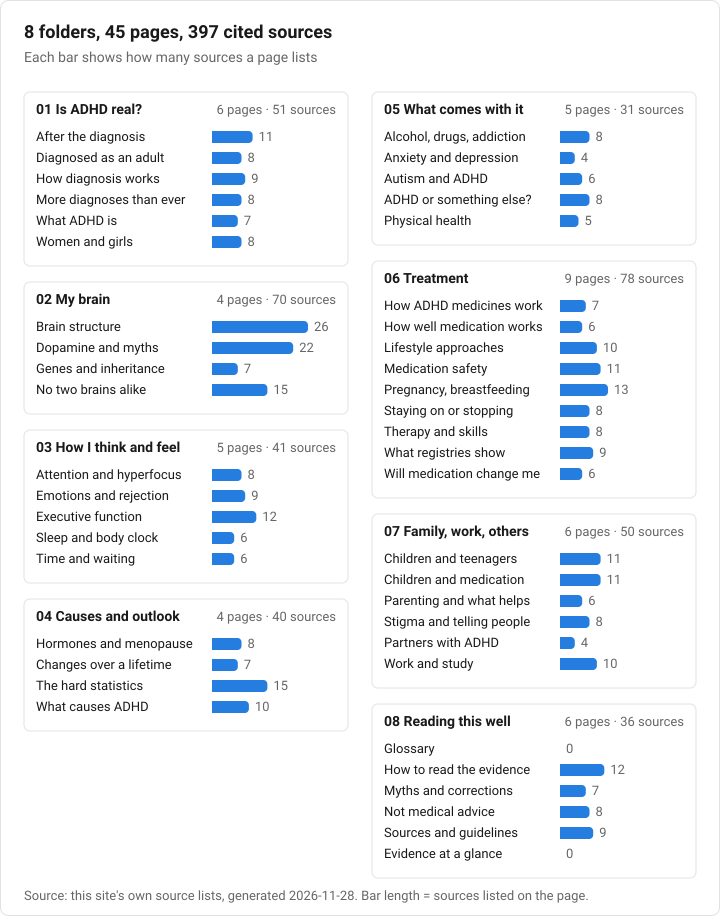
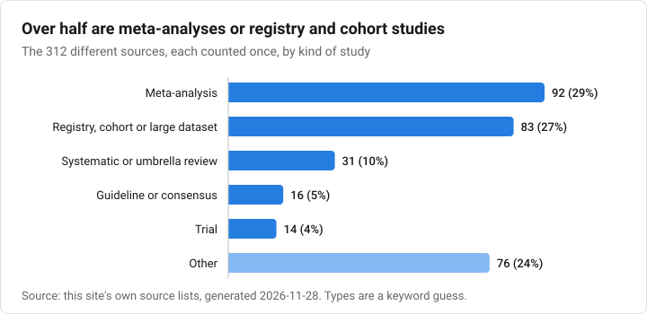
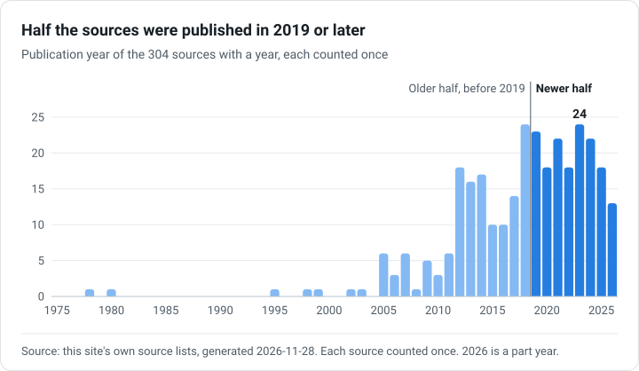

# What evidence do these pages rest on, taken as a whole?

> **Short answer:** Across the site, about seven in ten cited sources are labelled Strong or Moderate, and over half the different sources are meta-analyses or large registry and cohort studies. The evidence is thinnest on hormones, emotions and rejection, stigma, and life after a diagnosis. These charts count sources; they do not measure whether the pages are right.

The charts below are drawn from the numbered source lists at the bottom of every page. They are regenerated by a script whenever pages change, so the numbers here match the pages at the date shown on each chart.

## The numbers in one table

<!-- corpus:summary -->
| What was counted | Number |
| --- | ---: |
| Content pages | 45 (43 with a source list) |
| Source entries across all pages | 397 |
| Different sources (each counted once) | 312 |
| Different sources with a DOI or PubMed ID | 287 (92%) |
| Entries labelled Strong | 108 (27%) |
| Entries labelled Moderate | 165 (42%) |
| Entries labelled Limited | 77 (19%) |
| Entries labelled Contested | 10 (3%) |
| Guidelines and consensus statements | 20 (5%) |
| Commentary, reviews or entries with no grade | 17 (4%) |
| Median publication year | 2019 |
<!-- /corpus:summary -->

"Source entries" counts every numbered source on every page. "Different sources" counts each paper once, even when several pages cite it.

## How the site is laid out

<!-- corpus:site-map -->
<picture>
  <source media="(prefers-color-scheme: dark)" srcset="../assets/charts/corpus/site-map-dark.svg">
  
</picture>

*The 8 folders and their pages. Longer bars mean more sources listed, not more reliable answers.*
<!-- /corpus:site-map -->

Pages that cover contested or technical ground, such as brain scans and dopamine, list the most sources. Short pages are not weaker for having fewer: some questions are answered well by one large review.

## How strong is the evidence, folder by folder?

<!-- corpus:evidence-by-folder -->
<picture>
  <source media="(prefers-color-scheme: dark)" srcset="../assets/charts/corpus/evidence-by-folder-dark.svg">
  
</picture>

*Evidence labels as written on each page. In-between grades such as "Limited to moderate" count toward the lower grade. Causes and outlook leans most on Limited evidence; What comes with it has the highest share of Strong or Moderate.*
<!-- /corpus:evidence-by-folder -->

Each source on a page carries a label written by the person who drafted or checked that page. **Strong** usually means a large meta-analysis or a very large study with consistent results. **Moderate** means good evidence with real limits. **Limited** means a small study, a single study or an early finding. **Contested** means good sources disagree. [Reading ADHD research](how-to-read-the-evidence.md) explains the labels in full.

The labels describe the source, not the sentence that cites it. A page can cite a Strong source for a careful, narrow point and still be uncertain overall, which is why every page has a "what is uncertain" section.

## What kinds of study are these?

<!-- corpus:study-types -->
<picture>
  <source media="(prefers-color-scheme: dark)" srcset="../assets/charts/corpus/study-types-dark.svg">
  
</picture>

*Kinds of study, guessed from each citation's title and notes, so some will be misfiled. "Other" includes narrative reviews, commentaries, single surveys and service pages.*
<!-- /corpus:study-types -->

Meta-analyses pool many studies, so they are the backbone of what is "established". Registry and cohort studies follow very large groups over time, often whole countries. They show what happens in real life but cannot prove cause on their own. Randomised trials are few here because the site leans on reviews that pool trials, rather than on single trials.

## How current is the evidence?

<!-- corpus:publication-years -->
<picture>
  <source media="(prefers-color-scheme: dark)" srcset="../assets/charts/corpus/publication-years-dark.svg">
  
</picture>

*44% of sources are from 2020 or later. Older papers mostly appear where they are the original study behind an idea.*
<!-- /corpus:publication-years -->

Treatment and genetics move fastest, so those pages favour recent reviews. Older papers usually appear because they are the original study behind an idea, such as early work on stimulants in children without ADHD.

## Which sources do many pages lean on?

<!-- corpus:most-reused -->
<picture>
  <source media="(prefers-color-scheme: dark)" srcset="../assets/charts/corpus/most-reused-dark.svg">
  
</picture>

*57 sources appear on two or more pages. Being cited often makes a source central to these pages, not more likely to be right.*
<!-- /corpus:most-reused -->

A few sources hold the site together: the 2025 *BMJ* umbrella review of treatments, the diagnostic manual (DSM-5-TR), the NICE guideline and the largest genetic and prevalence studies. If one of these were wrong, several pages would be wrong together. That is a reason to check them first, not a sign that they are wrong.

## Where the evidence is thin

These pages have half or more of their sources labelled **Limited**. Their answers are honest about it, but they rest on smaller or newer research.

<!-- corpus:thin-pages -->
- [Do periods, pregnancy and menopause make ADHD worse?](../04-did-i-cause-this-and-where-is-it-going/hormones-cycles-and-menopause.md): 7 of 8 sources labelled Limited
- [Just diagnosed with ADHD: why do I feel relieved, sad and doubtful?](../01-is-this-real/after-the-diagnosis.md): 7 of 11 sources labelled Limited
- [ADHD stigma and shame: should I tell people?](../07-family-work-and-other-people/stigma-and-telling-people.md): 5 of 8 sources labelled Limited
- [ADHD myths: which popular claims are wrong or half right?](myths-and-corrections.md): 4 of 7 sources labelled Limited
- [Emotions and rejection in ADHD: why do they hit so hard?](../03-why-i-think-and-feel-this-way/emotions-and-rejection.md): 5 of 9 sources labelled Limited
- [Will ADHD medication change my personality or make me a zombie?](../06-treatment-what-works/will-medication-change-me.md): 3 of 6 sources labelled Limited
- [Partner with ADHD: what does research say about relationships?](../07-family-work-and-other-people/when-your-partner-has-adhd.md): 2 of 4 sources labelled Limited
<!-- /corpus:thin-pages -->

Two patterns stand out. Questions about lived experience (life after a diagnosis, stigma, partners) draw on interview studies and small surveys. Newer ideas such as hyperfocus, rejection sensitivity and hormonal effects have little research behind them yet. Folder 08 also has many ungraded entries, because its sources include crisis services and guidelines rather than studies.

## What is uncertain or debated

- **Counting is not checking.** A page with 20 sources is not more reliable than one with 6. These charts show where the pages lean, not whether they are correct.
- **The labels are judgements.** They were given by AI drafters and checkers working from abstracts and index records, almost never full texts. A clinician or methodologist might grade some sources differently.
- **The study types are guessed.** A script sorts each source by words in its title and notes, so some sources are misfiled. A "meta-analysis" of five small studies and one of 300 count the same.
- **No clinician has reviewed these pages.** [Where does the information on these pages come from?](sources-and-guidelines.md) explains how the pages were written and checked.

## What this means for you

Use these charts to judge how much weight a part of the site can bear. Where a folder leans on **Limited** evidence, treat its answers as a starting point. If a specific number matters to you, open the source it cites, or take it to a clinician.

## Related pages

- [Where does the information on these pages come from?](sources-and-guidelines.md)
- [Reading ADHD research: what do the numbers really mean?](how-to-read-the-evidence.md)
- [Can these pages tell me what to do about my ADHD?](not-medical-advice.md)
- [Back to all worries](../README.md#find-your-worry)

## How these charts are made

The charts come from `tools/charts/corpus.py`, which reads every page's source list and writes `assets/charts/corpus/corpus.json`. Run `python3 tools/charts/corpus.py` to refresh the charts and the numbers on this page. In-between grades such as "Limited to moderate" count toward the lower grade, so the charts never overstate the evidence.

---
Last reviewed: November 2026 · [How these pages are made](sources-and-guidelines.md) · [Not medical advice](not-medical-advice.md)
